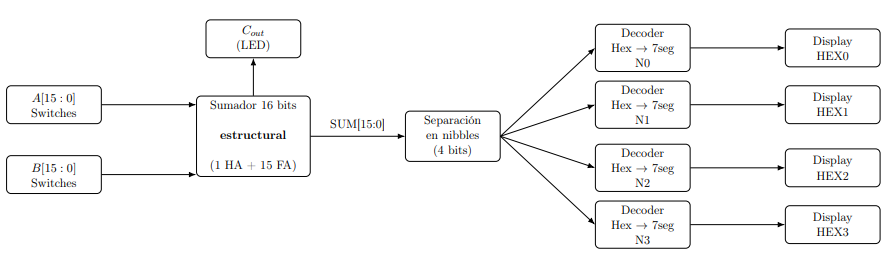
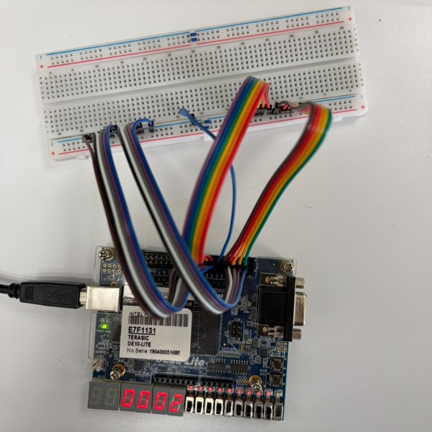
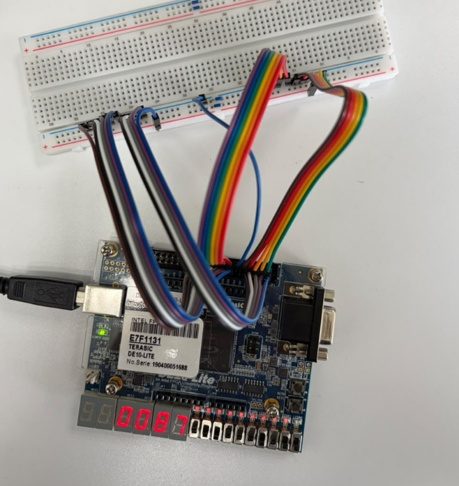
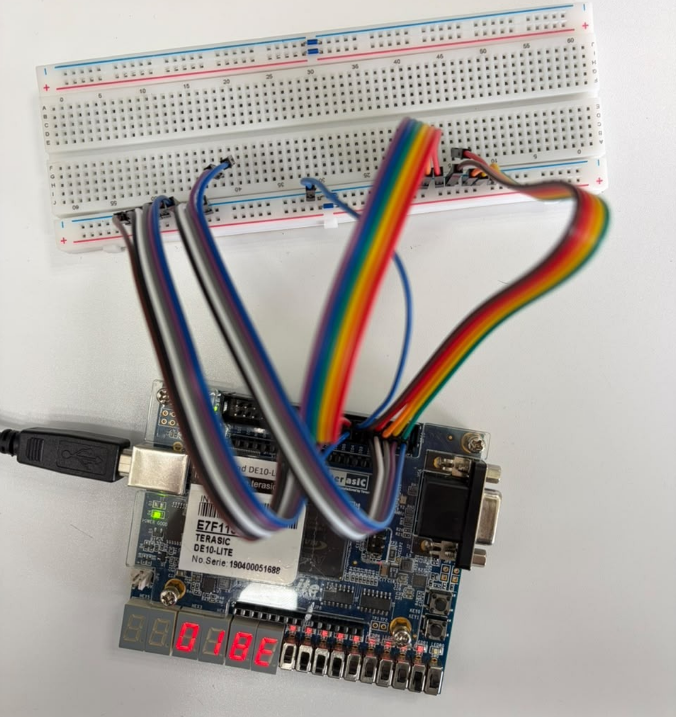

# Reporte de Práctica 1: Sumador de 16 bits estructural y despliegue hexadecimal en 7 segmentos

**Miguel Ángel Sarmiento Luna · Juan Diego Acosta Ojeda**
Universidad de las Américas Puebla (UDLAP)
Departamento de Computación, Electrónica y Mecatrónica
11 de septiembre de 2026

---

## Resumen

En esta práctica se diseña e implementa un sumador de 16 bits utilizando una descripción estructural basada en dos celdas: medio sumador (HA) y sumador completo (FA). El resultado de la suma se divide en nibbles para mostrarse en formato hexadecimal mediante cuatro decodificadores binario a 7 segmentos, desplegándose en los cuatro displays de 7 segmentos de la tarjeta Terasic DE10-Lite. La validación del diseño se realiza primero en simulación (Active-HDL) y posteriormente se compila e implementa en la FPGA usando Quartus Lite.

## Objetivos

1. Diseñar un sumador de 16 bits de forma estructural usando celdas HA y FA.
2. Integrar el sumador con decodificadores binario a 7 segmentos para desplegar el resultado en hexadecimal.
3. Simular el funcionamiento del sistema en Active-HDL (pruebas funcionales) y luego compilar/implementar en Quartus Lite para la DE10-Lite.

## Marco teórico

En el diseño de sistemas embebidos y procesadores, la adición binaria representa la operación aritmética elemental de la Unidad Aritmética Lógica (ALU). Para construir sumadores, tenemos dos bloques a considerar:

### Medio sumador

Un medio sumador (*half-adder*) es un circuito digital que realiza la suma de números binarios. Es el sumador digital más simple y se puede construir usando solo dos puertas lógicas: una puerta XOR y una puerta AND. El medio sumador solo puede sumar dos números de 1 bit [[1]](#referencias), [[2]](#referencias), [[3]](#referencias).

### Sumador de acarreo en cascada de 16 bits (Ripple-Carry)

Conecta celdas de suma en serie donde el acarreo de salida $(C_{out})$ de una etapa sirve como acarreo de entrada $(C_{in})$ de la siguiente. Es óptimo en consumo de compuertas lógicas dentro de la FPGA, aunque su tiempo de estabilización depende de la propagación del acarreo a lo largo de los 16 bits [[4]](#referencias).

El sumador toma dos entradas, A y B, y genera dos salidas: una para la suma $(S)$ y otra para el acarreo $(C_{out})$. El bit 0 se implementa con el primer medio sumador (donde $c_{in} = 0$) y los bits 1 a 15 con 15 FA [[2]](#referencias), [[3]](#referencias).

### Sumador completo

Un sumador completo es un circuito digital que suma tres entradas binarias. Un sumador completo puede sumar tres números binarios de 1 bit, lo que significa que puede tomar un bit de acarreo de un sumador anterior, logrando un rango de suma de 0 a 3, que puede expresarse con dos bits de salida.

Se puede construir un sumador completo utilizando dos circuitos de medio sumador y una puerta OR. El primer medio sumador tiene dos entradas binarias de 1 bit, A y B. Produce dos salidas: suma (S) y acarreo ($C_{out}$). La salida de suma del primer semisumador será la primera entrada del segundo semisumador. Y la salida de acarreo del primer semisumador será la segunda entrada de la puerta OR adicional [[5]](#referencias).

### Decodificador de hexadecimal a 7 segmentos

Es un circuito lógico combinacional cuya función principal es traducir una entrada binaria de cuatro bits, representativa de los dieciséis caracteres del sistema hexadecimal (0-9 y A-F), en un conjunto de siete señales de salida. Estas salidas están lógicamente diseñadas para activar o desactivar los segmentos individuales (etiquetados convencionalmente de la *a* a la *g*) de un visualizador electrónico, mostrando entonces la representación gráfica correspondiente al valor digital obtenido en la suma [[6]](#referencias).

## Planteamiento del experimento

### Esquema de bloques del sistema

A continuación, se adjunta el diagrama de bloques del sistema propuesto para la práctica.

  
   
  <em>Figura 1. Esquema de bloques del sistema.</em>

Se tienen 2 entradas (A y B) que entran al sumador de 16 bits, cuyas salidas son 2 (S y $C_{out}$), que recaen en un separador de nibbles. Posteriormente, pasan por los 4 decodificadores de hexadecimal a 7 segmentos, para terminar mostrándose en cada display.

### Plataforma hardware y herramientas software

Para el desarrollo se utilizaron las herramientas oficiales y la plataforma física requerida:

- **Active-HDL:** entorno para la compilación, verificación funcional y análisis de formas de onda antes de la etapa de síntesis.
- **Intel Quartus Prime Lite:** software encargado de la síntesis lógica, el mapeo de puertos físicos mediante el Pin Planner, la generación del archivo de programación y la descarga al hardware.
- **FPGA Terasic DE10-Lite (Intel MAX 10 10M50DAF484C7G):** tarjeta de desarrollo que contiene los displays de 7 segmentos, LEDs, switches y pines GPIO.
- **Entradas externas:** dado que se requieren números de 16 bits para $A[15:0]$ y $B[15:0]$, se utilizaron jumpers macho-hembra conectados de los pines GPIO hacia una protoboard.

### Fundamento teórico y jerarquía estructural

El circuito se organizó a partir de una descripción estructural respetando la jerarquía definida:

- [`Half_Adder`](Half_Adder.v)
- [`Full_Adder`](Full_Adder.v)
- [`Sumador_16bits`](Sumador_16bits.v)
- [`Hex_7seg`](Hex_7seg.v)
- [`Top_design`](Top_design.v)

**1. Medio sumador.**
Se creó un proyecto en el software Active-HDL con el objetivo de diseñar un medio sumador. Se describió el medio sumador usando las compuertas lógicas AND y XOR, que corresponden a las salidas de acarreo y suma. Posteriormente, se compiló el código y se realizó una simulación asignando los valores de 0 y 1 a las entradas. Para concluir, se verificó el correcto funcionamiento del medio sumador cuando se compararon los resultados con la tabla de verdad teórica para un medio sumador. Sus ecuaciones lógicas corresponden a:

$$s = a \oplus b \tag{1}$$

$$c = a \cdot b \tag{2}$$

**2. Sumador completo.**
Se desarrolló un sumador completo en un nuevo archivo dentro del entorno de Active-HDL. Para implementar este diseño se conectaron dos medios sumadores y una compuerta OR para el acarreo final. Después de la compilación, se realizó una simulación asignando valores de 0 y 1 a las entradas. Finalmente, se compararon los resultados obtenidos con la tabla de verdad correspondiente a un sumador completo, confirmando un comportamiento adecuado. Sus ecuaciones lógicas corresponden a:

$$s = a \oplus b \oplus c_{\text{in}} \tag{3}$$

$$c_{\text{out}} = (a \cdot b) + \big((a \oplus b) \cdot c_{\text{in}}\big) \tag{4}$$

**3. Sumador de 16 bits.**
Se implementó el diseño de un sumador de 16 bits conectando los módulos previamente creados. Para la primera etapa del bit menos significativo se instanció el módulo del medio sumador, ya que no se requiere procesar ningún acarreo de entrada. Para los 15 bits restantes se instanciaron quince módulos de sumador completo, interconectando el acarreo de salida de cada etapa con la entrada de acarreo de la siguiente etapa consecutiva mediante señales internas. El último acarreo generado en la etapa más significativa se extrajo directamente como la señal $C_{\text{out}}$ para encender un LED que indica el desbordamiento. Posteriormente, se compiló el archivo en Active-HDL y se aplicaron vectores de prueba con sumas simples, confirmando que la suma binaria total de 16 bits se generara de forma correcta.

**4. Decodificador hexadecimal a 7 segmentos.**
Se diseñó un decodificador combinacional para traducir cada valor binario de 4 bits al encendido correspondiente de los 7 segmentos ($A, B, C, D, E, F, G$). Se partió de la tabla de verdad para las combinaciones hexadecimales del `0` al `F`, asignando las variables de entrada como $b_3, b_2, b_1, b_0$. A partir de dicha tabla, se elaboró un mapa de Karnaugh individual para cada una de las 7 salidas y se agruparon los unos lógicos para deducir sus formas canónicas. Estas ecuaciones simplificadas se implementaron directamente al módulo mediante descripción de flujo de datos.

**5. Módulo superior.**
Se integró el sistema completo para coordinar el procesamiento de datos entre el sumador y las salidas visuales de la tarjeta. Se declararon las entradas de 16 bits $A[15:0]$ y $B[15:0]$, la salida de desbordamiento `Cout`, y los cuatro buses de 7 bits $D0, D1, D2, D3$ que controlan a los displays. Primero, se instanció el sumador estructural de 16 bits para sumar los operandos y producir el bus de resultado $S[15:0]$ junto con el acarreo `Cout`. Posteriormente, la palabra de 16 bits se descompuso en cuatro nibbles independientes para alimentar a cuatro instancias del decodificador. Se agregaron asignaciones continuas para invertir bit a bit las salidas de los displays debido a que éstos operan con lógica negada: se activan cuando reciben un 0.

### Mapeo de segmentos activos en bajo

En la Tabla 1 se detalla la conversión que se realiza para asegurar que cada dígito se represente adecuadamente en los displays de ánodo común.

*Tabla 1. Tabla de decodificación (HEX[6:0] = $g,f,e,d,c,b,a$).*

| Entrada | Dígito mostrado | Segmentos activos |
|:--:|:--:|:--:|
| `0000` | 0 | $a,b,c,d,e,f$ |
| `0001` | 1 | $b,c$ |
| `0010` | 2 | $a,b,d,e,g$ |
| `0011` | 3 | $a,b,c,d,g$ |
| `0100` | 4 | $b,c,f,g$ |
| `0101` | 5 | $a,c,d,f,g$ |
| `0110` | 6 | $a,c,d,e,f,g$ |
| `0111` | 7 | $a,b,c$ |
| `1000` | 8 | $a,b,c,d,e,f,g$ |
| `1001` | 9 | $a,b,c,d,f,g$ |
| `1010` | A | $a,b,c,e,f,g$ |
| `1011` | b | $c,d,e,f,g$ |
| `1100` | C | $a,d,e,f$ |
| `1101` | d | $b,c,d,e,g$ |
| `1110` | E | $a,d,e,f,g$ |
| `1111` | F | $a,e,f,g$ |

## Análisis de resultados

El análisis experimental permitió comprobar cómo se relacionan la descripción estructural frente a su comportamiento lógico en la tarjeta FPGA.

La estructura del sumador elegido corresponde a un sumador por propagación de acarreo. Es decir, el tiempo que tarda el circuito en arrojar su salida depende del camino que recorre el acarreo desde el bit menos significativo hasta el bit más significativo, en este caso desde el bit 0 al bit 15. En el peor caso, el retardo total se define como:

$$t_{\text{total}} = t_{\text{HA}} + 15 \cdot t_{\text{FA}} \tag{5}$$

donde $t_{\text{HA}}$ es el retardo del medio sumador en la primera etapa ($S_0$), y $t_{\text{FA}}$ es el tiempo que toma cada sumador completo en calcular y pasar el acarreo a la etapa siguiente.

El peor caso ocurre con la suma `0xFFFF` + `0x0001`, donde el bit 0 genera un acarreo inicial que debe viajar por los 15 módulos `Full_Adder` restantes. Cada celda recibe el acarreo previo, convierte su bit a cero y genera un nuevo acarreo, hasta encender la bandera de desbordamiento $C_{\text{out}}$.

Para validar las operaciones y la decodificación hacia los displays, se analizaron tres casos representativos:

- **Operación básica.** Se sumó $1 + 1 = 2$. Con esto se confirmó que el medio sumador inicial opera bien y que no se generan acarreos erróneos hacia los submódulos superiores.

  

    
     
    <em>Figura 2. Suma de 1 + 1 = 2 (216).</em>
  

- **Múltiples displays.** Al sumar $50 + 85 = 135$, se verificó que las etapas intermedias resuelven la suma correctamente y que los decodificadores trabajan correctamente.

  

    
     
    <em>Figura 3. Suma de 50 + 85 = 135 (8716).</em>
  

- **Suma con tres dígitos.** Al sumar $125 + 273 = 398$, el resultado en hexadecimal corresponde a `0x018E`, desplegándose correctamente en los displays.

  

    
     
    <em>Figura 4. Suma de 125 + 273 = 398 (18E16).</em>
  

## Conclusión

La práctica nos permitió comprender a fondo el flujo de trabajo completo en el diseño digital, desde la descripción estructural y simulación hasta la integración de jumpers y protoboard en la FPGA. Al construir el sumador de 16 bits a partir de bloques elementales (1 HA y 15 FA), comprobamos físicamente el comportamiento teórico del acarreo y su propagación a través de las etapas.

A su vez, el uso de Active-HDL fue fundamental para verificar los vectores límite y los casos de desbordamiento antes de proceder a la síntesis en Quartus Lite. Finalmente, la implementación en la tarjeta DE10-Lite demostró cómo estructurar correctamente las interfaces de salida.

## Referencias

1. Build Electronic Circuits, "Half Adder Circuit – How it Works," 2022. [En línea]. Disponible en: <https://www.build-electronic-circuits.com/half-adder/>. [Accedido: 07/01/2026].
2. M. M. Mano y M. D. Ciletti, *Digital Design: With an Introduction to the Verilog HDL, VHDL, and SystemVerilog*, 6.ª ed. Pearson, 2017.
3. J. F. Wakerly, *Digital Design: Principles and Practices*, 4.ª ed. Pearson/Prentice Hall, 2006.
4. E. Technology, "Ripple carry and carry look ahead Adder," Electrical Technology, 4 abr. 2018. [En línea]. Disponible en: <https://www.electricaltechnology.org/2018/04/ripple-carry-and-carry-look-ahead-adder.html>. [Accedido: 07/01/2026].
5. Build Electronic Circuits, "Full Adder Circuit – How it Works," 2022. [En línea]. Disponible en: <https://www.build-electronic-circuits.com/full-adder/>. [Accedido: 07/01/2026].
6. W. Electronica, "Decodificador hexadecimal a 7 segmentos," Wilaeba Electronica, 12 sep. 2018. [En línea]. Disponible en: <https://wilaebaelectronica.blogspot.com/2017/10/decodificador-hexadecimal-7-segmentos.html>. [Accedido: 07/01/2026].
