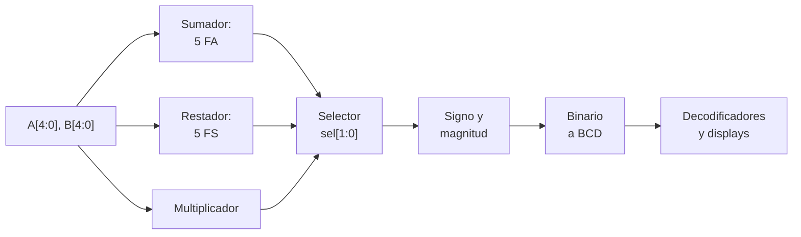
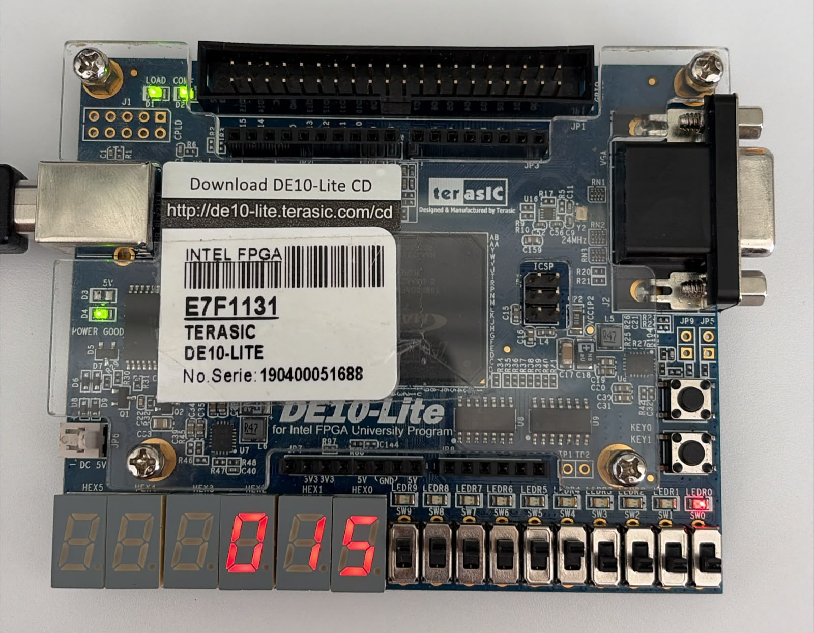
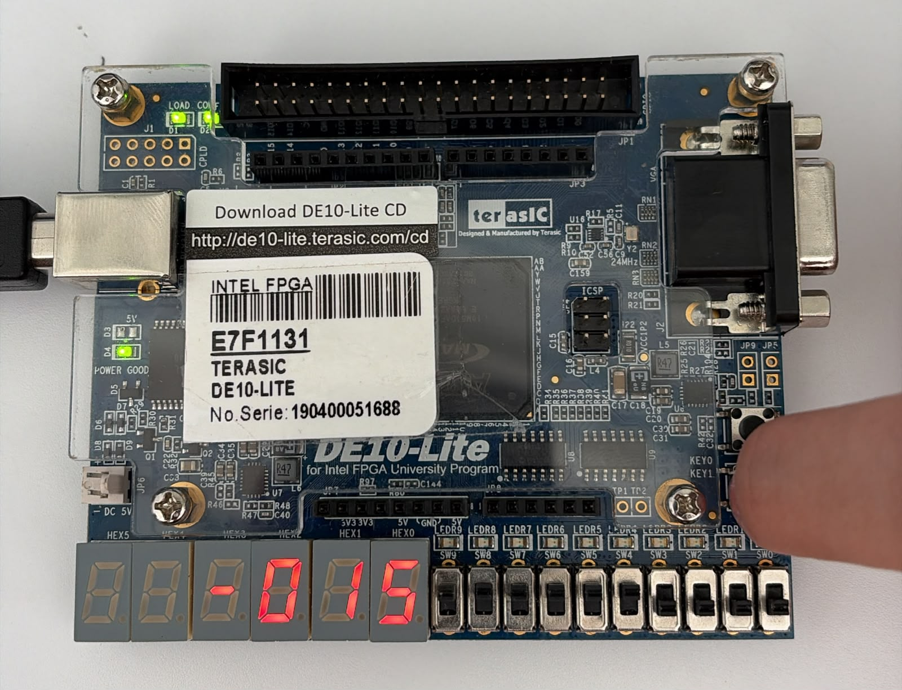
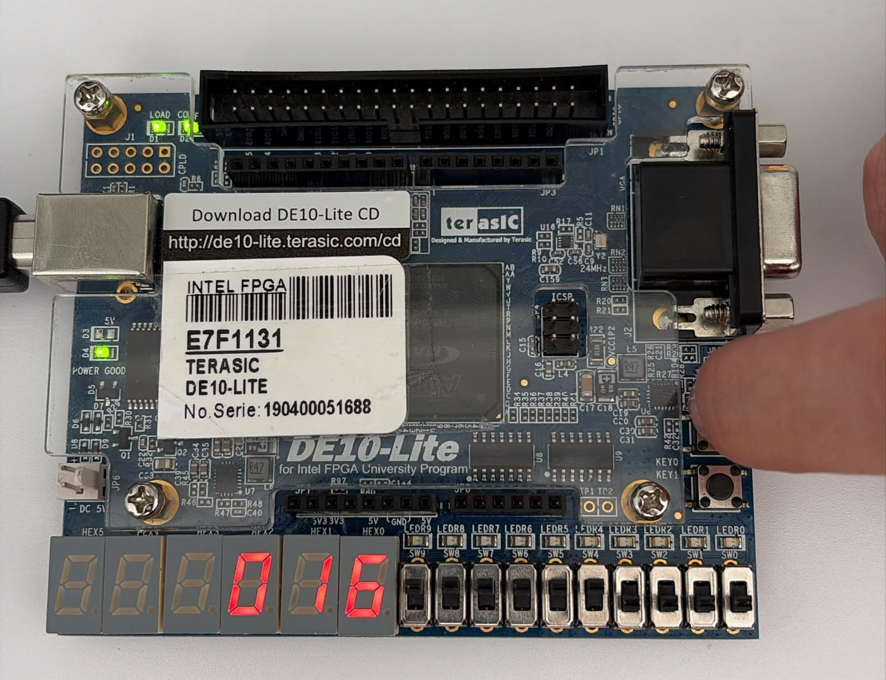
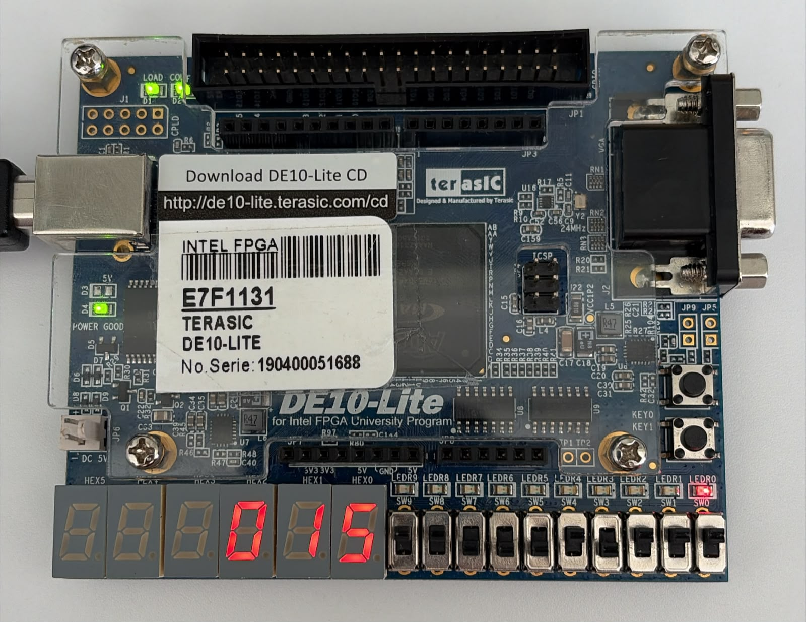
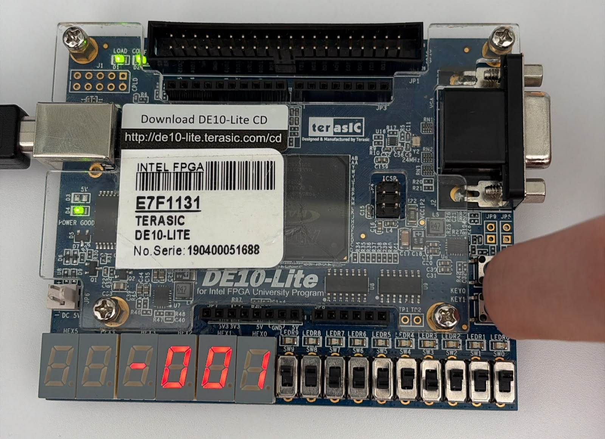
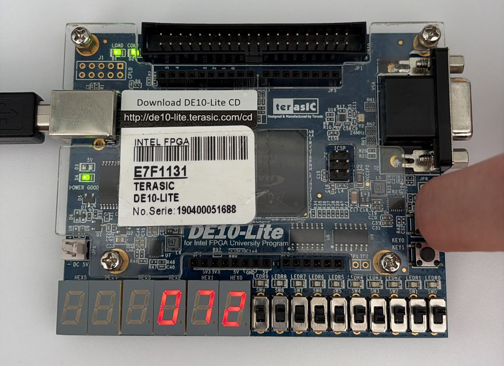
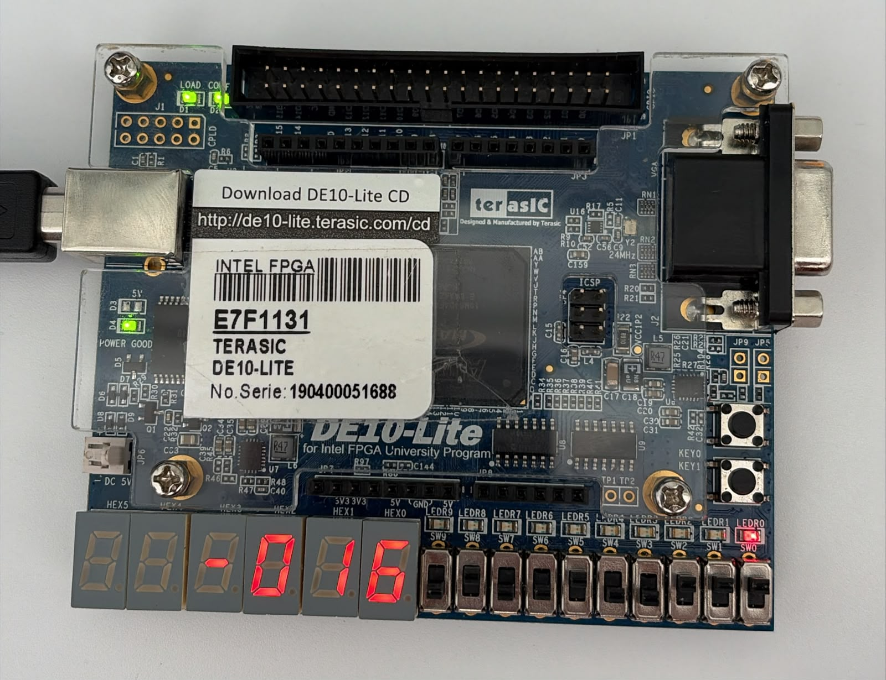
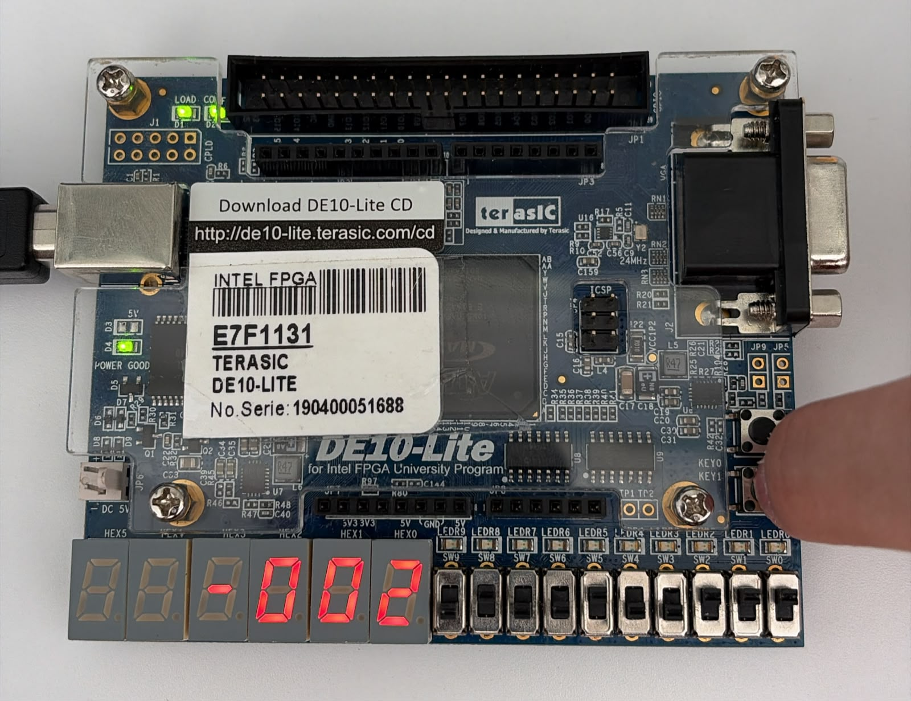
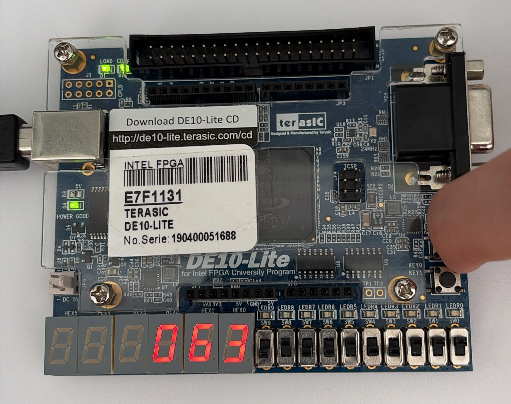

# Reporte de Práctica 2: Implementación de una ALU de 5 bits con signo y despliegue decimal en FPGA

**Miguel Ángel Sarmiento Luna · Juan Diego Acosta Ojeda**
Universidad de las Américas Puebla (UDLAP)
Departamento de Computación, Electrónica y Mecatrónica

---

## Resumen

En esta práctica se plantea el diseño e implementación de una Unidad Aritmético-Lógica (ALU) que realiza suma, resta y multiplicación entre dos operandos de 5 bits con signo. Posteriormente, un selector determina la operación que se envía a la etapa de conversión decimal y a los displays de 7 segmentos de la tarjeta.

## Objetivos

Diseñar e implementar una Unidad Aritmético-Lógica (ALU) de 5 bits utilizando lenguaje Verilog y la plataforma FPGA DE10-Lite. El sistema deberá realizar operaciones de suma, resta y multiplicación entre dos operandos con signo, mostrando el resultado en formato decimal mediante displays de 7 segmentos. El desarrollo deberá realizarse utilizando el entorno Quartus Prime.

## Marco teórico

### Representación de números con signo

El complemento a dos permite representar números positivos y negativos en una misma palabra binaria. Para obtener la representación de un número negativo se invierten los bits de su magnitud y se suma uno, conservando el ancho de la palabra [[1]](#referencias). Para esta práctica, el valor de una entrada se obtiene mediante:

$$N = -16b_4 + 8b_3 + 4b_2 + 2b_1 + b_0 \tag{1}$$

De acuerdo con la Ecuación 1, el intervalo disponible es de $-16$ a $15$. Los cinco bits ya incluyen el signo. Por ejemplo, $10000_2$ representa $-16$ y $11111_2$ representa $-1$. El bit más significativo tiene peso negativo, los otros cuatro bits no representan por sí solos la magnitud de un número negativo.

### Sumador completo y conexión en cascada

Un sumador completo recibe dos bits y un acarreo de entrada. Produce un bit de suma y un acarreo de salida [[2]](#referencias). Las siguientes ecuaciones describen ambas salidas:

$$s_i = a_i \oplus b_i \oplus c_i \tag{2}$$

$$c_{i+1} = a_i b_i + (a_i \oplus b_i)\, c_i \tag{3}$$

En la Ecuación 3, el signo $+$ indica OR y la multiplicación indica AND. Al conectar cinco etapas, el acarreo de una se utiliza como entrada de la siguiente. Para sumar únicamente los operandos, se fija $c_0 = 0$. Esta organización permite reutilizar una misma celda, aunque la salida depende de la propagación del acarreo entre etapas.

### Restador completo

El restador completo calcula la diferencia de dos bits considerando un préstamo de entrada [[3]](#referencias). Sus salidas se describen mediante las siguientes ecuaciones:

$$d_i = a_i \oplus b_i \oplus p_i \tag{4}$$

$$p_{i+1} = \overline{a_i}\, b_i + \overline{a_i}\, p_i + b_i\, p_i \tag{5}$$

Para una resta $A-B$, el préstamo inicial es cero. Posteriormente, cada etapa transmite su préstamo a la siguiente. La Ecuación 5 incluye las negaciones de $a_i$, necesarias para detectar cuándo el minuendo no alcanza para efectuar la resta. El préstamo final y el desbordamiento con signo son señales distintas.

### Multiplicación binaria

La multiplicación binaria permite obtener el producto de dos operandos. En esta práctica se implementó mediante una tabla de consulta o LUT (*Look-Up Table*), que relaciona cada combinación de entradas con su resultado correspondiente. De esta manera, los valores de A y B permiten seleccionar el producto almacenado en la tabla.

Se utilizan 10 bits con signo para representar todos los resultados posibles. Posteriormente, se separan el signo y la magnitud del producto para convertirlo a decimal y mostrarlo en los displays de 7 segmentos.

### Conversión decimal y displays

La codificación BCD asigna cuatro bits a cada dígito decimal. El decodificador de 7 segmentos convierte cada dígito en señales de encendido para el display; esta conversión también puede extenderse a caracteres hexadecimales [[4]](#referencias).

Para desplegar un resultado negativo se separan el signo y la magnitud. Si $M = |R|$, las centenas, decenas y unidades satisfacen la Ecuación 6:

$$M = 100C + 10D + U, \qquad 0 \leq C, D, U \leq 9 \tag{6}$$

La Ecuación 6 permite verificar la conversión independientemente de la operación aritmética. Por ejemplo, 63 se representa con $C=0$, $D=6$ y $U=3$. El signo requiere una indicación adicional o una distribución de displays que lo contemple.

## Planteamiento del experimento

### Esquema de bloques del sistema

La Figura 1 presenta la organización funcional indicada por la guía. Las entradas se distribuyen a los tres módulos aritméticos; el selector determina cuál de sus resultados se envía al despliegue.

*Figura 1. Organización funcional de la ALU.*

### Plataforma hardware y herramientas software

La implementación física se realizó en la tarjeta Terasic DE10-Lite, utilizando sus interruptores, pulsadores, LEDs y displays de 7 segmentos. El código Verilog se compiló en Active-HDL. Posteriormente, en Quartus Prime Lite se realizó la síntesis, la asignación de pines y la generación del archivo de programación para configurar la FPGA.

### Fundamento teórico y jerarquía estructural

La organización requerida contempla los siguientes bloques:

1. **Sumador completo y sumador de 5 bits:** cinco instancias conectadas por acarreos ([`full_adder.v`](full_adder.v), [`adder_5bits.v`](adder_5bits.v)).
2. **Restador completo y restador de 5 bits:** cinco etapas conectadas mediante préstamos ([`full_restador.v`](full_restador.v), [`restador_5bits.v`](restador_5bits.v)).
3. **Multiplicador mediante LUT:** consulta del producto correspondiente a los operandos con signo y salida de 10 bits ([`multiplicador_LUT.v`](multiplicador_LUT.v)).
4. **Selector:** selección de uno de los resultados mediante las combinaciones de la Tabla 1 ([`selector.v`](selector.v)).
5. **Conversión y despliegue:** separación del signo, obtención de dígitos decimales y activación de los segmentos correspondientes ([`magnitud.v`](magnitud.v), [`Bin_Bcd.v`](Bin_Bcd.v), [`decoder_7seg.v`](decoder_7seg.v)).

*Tabla 1. Selección de operación especificada en la guía.*

| Selector | Operación | Expresión |
|:--:|:--:|:--:|
| 00 | Suma | $A+B$ |
| 01 | Resta | $A-B$ |
| 10 | Multiplicación | $A \times B$ |
| 11 | No importa | — |

### Procedimiento de validación

Para la comparación se utilizaron tres parejas de operandos reportadas por el equipo: $(-16,-1)$, $(-8,-7)$ y $(7,9)$. Se calcularon la suma, la resta $A-B$ y el producto de cada pareja. Posteriormente se leyeron los dígitos, el signo y el estado visible de LEDR0 en cada fotografía, conservando la identificación de operación de los archivos originales.

La Tabla 2 presenta los patrones de entrada esperados según la Ecuación 1. Estos patrones son la referencia para revisar los interruptores; no sustituyen la comprobación de su asignación física.

*Tabla 2. Representación teórica de los operandos reportados.*

| Decimal | $-16$ | $-1$ | $-8$ | $-7$ | $7$ / $9$ |
|:--:|:--:|:--:|:--:|:--:|:--:|
| Binario | 10000 | 11111 | 11000 | 11001 | 00111 / 01001 |

## Análisis de resultados

### Comparación entre teoría e implementación física

La Tabla 3 compara los resultados teóricos con las lecturas de las nueve fotografías. Las columnas A y B indican los operandos previstos para cada prueba. En el grupo de $-8$ y $-7$ se presentó un error al configurar las entradas, por lo que las lecturas de suma y multiplicación no corresponden a los resultados esperados para esa pareja.

*Tabla 3. Resultados teóricos y lecturas de las nueve fotografías.*

| Caso | $A$ | $B$ | Operación | Exacto | Display | LEDR0 |
|:--:|:--:|:--:|:--:|:--:|:--:|:--:|
| 1 | $-16$ | $-1$ | Suma | $-17$ | 015 | Encendido |
| 2 | $-16$ | $-1$ | Resta | $-15$ | $-015$ | Apagado |
| 3 | $-16$ | $-1$ | Producto | $16$ | 016 | Apagado |
| 4 | $-8$ | $-7$ | Suma | $-15$ | 015 | Encendido |
| 5 | $-8$ | $-7$ | Resta | $-1$ | $-001$ | Apagado |
| 6 | $-8$ | $-7$ | Producto | $56$ | 072 | Apagado |
| 7 | $7$ | $9$ | Suma | $16$ | $-016$ | Encendido |
| 8 | $7$ | $9$ | Resta | $-2$ | $-002$ | Apagado |
| 9 | $7$ | $9$ | Producto | $63$ | 063 | Apagado |

El signo se muestra en el display Hex3, por ello, 015 sin signo se interpreta como $+15$. En los casos 1 y 7, LEDR0 se encuentra encendido debido al desbordamiento de la suma.

### Pruebas con $-16$ y $-1$

Al sumar $-16+(-1)$ se obtiene $-17$, que queda por debajo del límite de $-16$. En la Figura 2 se observa que la tarjeta muestra 015 y mantiene el led de overflow/underflow encendido. Esto se explica porque, al conservar únicamente cinco bits, el resultado es $01111_2$, que representa 15. Por lo tanto, el cambio de signo corresponde al desbordamiento de la suma.

  
   
  <em>Figura 2. Suma de −16 + (−1): lectura 015 y led de overflow/underflow encendido.</em>

Posteriormente, se revisó la resta $-16-(-1)=-15$. En la Figura 3 se muestra $-015$, coincidiendo con el cálculo tanto en la magnitud como en el signo. En este caso, el resultado se encuentra dentro del rango de representación y el led de overflow/underflow permanece apagado.

  
   
  <em>Figura 3. Resta de −16 − (−1): lectura −015 y led de overflow/underflow apagado.</em>

Para la multiplicación, el resultado esperado es $(-16)(-1)=16$. En la Figura 4 se observa 016, por lo que el producto coincide con el cálculo teórico. Este valor requiere más de 5 bits con signo, pues el máximo positivo que se puede representar con ese ancho es 15. Al conservar el producto en una salida de mayor tamaño, es posible mostrarlo correctamente.

  
   
  <em>Figura 4. Multiplicación de (−16)(−1): lectura 016 y led de overflow/underflow apagado.</em>

### Pruebas con $-8$ y $-7$

Para este grupo de pruebas se planteó utilizar los operandos $-8$ y $-7$, cuyos resultados esperados son $-15$ para la suma, $-1$ para la resta y 56 para la multiplicación. Sin embargo, durante la configuración de las entradas se cometió un error, por lo que las fotografías no corresponden en todos los casos a la pareja de valores prevista.

En la Figura 5, la suma muestra 015 sin signo negativo y con el led de overflow/underflow encendido. Este resultado no corresponde a $-8+(-7)=-15$, ya que dicha operación se encuentra dentro del rango de cinco bits con signo.

  
   
  <em>Figura 5. Prueba de suma con −8 y −7: lectura 015 y led de overflow/underflow encendido.</em>

En la Figura 6 se observa $-001$, que coincide con el resultado esperado de $-8-(-7)=-1$. El signo negativo se muestra correctamente y el led de overflow/underflow permanece apagado.

  
   
  <em>Figura 6. Prueba de resta prevista con −8 y −7: lectura −001 y led de overflow/underflow apagado.</em>

Para la multiplicación se esperaba obtener $(-8)(-7)=56$. Sin embargo, en la Figura 7 se muestra 072. Esta diferencia se debió a un error al configurar los operandos de entrada durante la prueba. Por lo tanto, el valor mostrado no debe interpretarse como el producto de $-8$ y $-7$ ni utilizarse para afirmar que el multiplicador calculó incorrectamente esa operación.

  
   
  <em>Figura 7. Prueba de multiplicación con un error en las entradas: lectura 072 y led de overflow/underflow apagado.</em>

### Pruebas con $7$ y $9$

Al sumar $7+9$, el resultado es 16 y supera el máximo positivo de 15. En la Figura 8 se muestra $-016$ y el led de overflow/underflow se encuentra encendido. Al igual que en la primera suma, el resultado se explica por el límite de cinco bits: el patrón $10000_2$ se interpreta como $-16$ en complemento a dos.

  
   
  <em>Figura 8. Suma de 7 + 9: lectura −016 y led de overflow/underflow encendido.</em>

Para la resta $7-9=-2$, la Figura 9 muestra $-002$, coincidiendo con el resultado esperado. En este caso, el signo negativo es parte del resultado y no indica un desbordamiento, ya que $-2$ se encuentra dentro del rango disponible. Esto también coincide con el estado apagado del led de overflow/underflow.

  
   
  <em>Figura 9. Resta de 7 − 9: lectura −002 y led de overflow/underflow apagado.</em>

Finalmente, en la Figura 10 se observa 063, correspondiente a $7\times9=63$. Con esta prueba se comprobó que el producto se muestra correctamente en decimal, utilizando 0 centenas, 6 decenas y 3 unidades. El led de overflow/underflow permanece apagado, y el resultado cabe en los 10 bits con signo considerados para la multiplicación.

  
   
  <em>Figura 10. Multiplicación de (7)(9): lectura 063 y led de overflow/underflow apagado.</em>

## Cuestionario

1. **¿Cuál es la ventaja de utilizar Full Adders en cascada?**
   Permiten construir sumadores de varios bits reutilizando una misma celda. La organización facilita la descripción estructural y la revisión por etapas. Su limitación es la dependencia del acarreo entre celdas.

2. **¿Cómo se propaga el acarreo en un sumador ripple carry?**
   El acarreo de salida de una etapa se conecta a la entrada de la siguiente, desde el bit menos significativo hacia el más significativo. Una modificación de las entradas puede requerir que varias etapas se estabilicen antes de obtener el resultado final.

3. **¿Cuál es la diferencia entre un multiplicador combinacional y uno secuencial?**
   El combinacional obtiene el producto mediante una red lógica y su salida se estabiliza después del retardo de esa red [[5]](#referencias). El secuencial conserva resultados parciales en registros y avanza durante varios ciclos de reloj, puede reutilizar recursos aritméticos a cambio de requerir control y varios ciclos por operación. La latencia y los recursos concretos dependen de cada diseño.

4. **¿Qué ventajas ofrece una FPGA frente a otras plataformas de implementación?**
   Permite reconfigurar el circuito, integrar funciones específicas y ejecutar bloques de hardware en paralelo [[6]](#referencias).

## Conclusión

La práctica nos permitió integrar los módulos de suma, resta y multiplicación en una ALU con operandos de 5 bits con signo. A través del selector de operaciones y la conversión a decimal, se mostraron los resultados en los displays de 7 segmentos de la tarjeta DE10-Lite. Como se observa en la Tabla 3, las restas de $-16-(-1)$ y $7-9$ coincidieron con los valores esperados de $-15$ y $-2$, mientras que las multiplicaciones de $(-16)(-1)$ y $(7)(9)$ mostraron correctamente 16 y 63. Estas pruebas permitieron comprobar el cálculo y el despliegue de los resultados para los casos revisados.

A su vez, las sumas $-16+(-1)$ y $7+9$ permitieron observar el comportamiento del circuito cuando el resultado supera el rango de cinco bits con signo. En las Figuras 2 y 8 se muestran los valores $15$ y $-16$, respectivamente, junto con el led de overflow/underflow encendido. Esto nos ayudó a comprender que el valor mostrado depende del ancho disponible y que la señal de desbordamiento es necesaria para identificar cuándo el resultado ya no representa la suma matemática exacta.

Durante las pruebas previstas con $-8$ y $-7$ se presentó un error en la configuración de las entradas. En particular, la lectura 072 de la multiplicación no corresponde al producto esperado de 56.

## Referencias

1. Universidad Nacional de Misiones, Facultad de Ingeniería, "Datos, Operadores y Expresiones: Complemento a dos," Aula Virtual. [En línea]. Disponible en: <https://aulavirtual.fio.unam.edu.ar/mod/book/view.php?chapterid=7899&id=35570&lang=en>. [Consultado: 01/10/2026].
2. Proyecto iCartesiLibri, "Electrónica Digital: Ejemplos y Ejercicios, Vol. 1," recurso alojado en Prometeo, Instituto de Matemáticas, UNAM. [En línea]. Disponible en: <https://prometeo.matem.unam.mx/recursos/VariosNiveles/iCartesiLibri/recursos/Electronica_Digital_Ejemplos_y_Ejercicios_Vol1/index.html>. [Consultado: 01/10/2026].
3. Electrónica Digital UCN, "Restador," 2014. [En línea]. Disponible en: <https://electroucn.blogspot.com/2014/06/Restador.html>. [Consultado: 01/10/2026].
4. Wilaeba Electrónica, "Decodificador hexadecimal a 7 segmentos." [En línea]. Disponible en: <https://wilaebaelectronica.blogspot.com/2017/10/decodificador-hexadecimal-7-segmentos.html>. [Consultado: 01/10/2026].
5. J. Barbero Pérez y J. L. Berenguel Gómez, "Multiplicador," Universidad de Almería, 2002. [En línea]. Disponible en: <https://www.hpca.ual.es/~vruiz/docencia/laboratorio_arquitectura/proyectos/01-02/prog3/multiplicador.html>. [Consultado: 01/10/2026].
6. J. Schneider e I. Smalley, "¿Qué es una matriz de puertas programables en campo (FPGA)?," IBM Think. [En línea]. Disponible en: <https://www.ibm.com/mx-es/think/topics/field-programmable-gate-arrays>. [Consultado: 01/10/2026].
