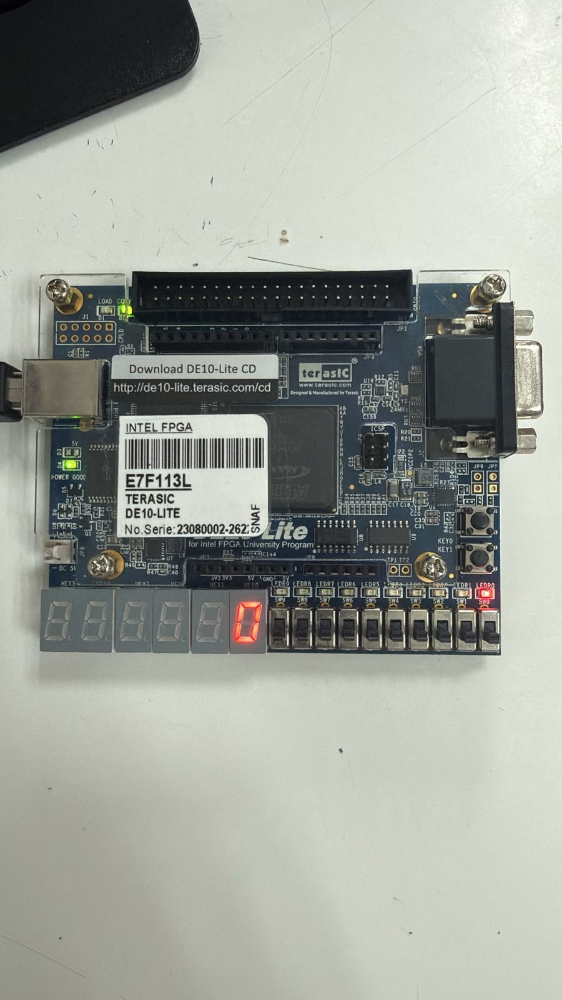
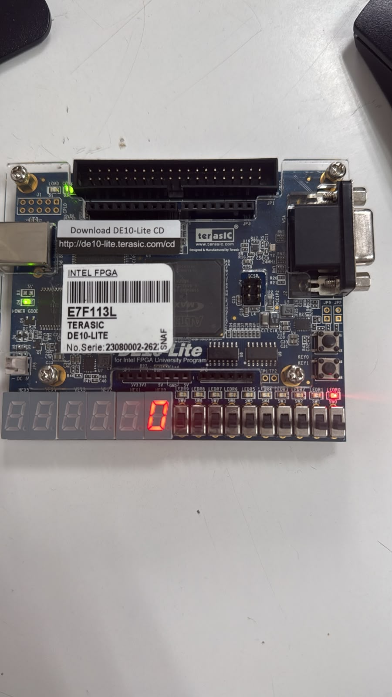
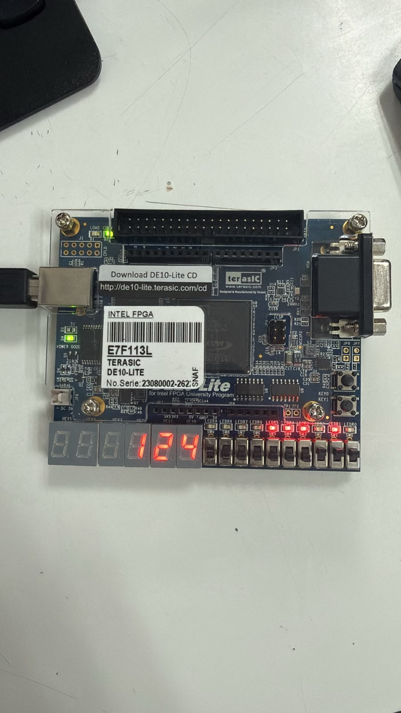
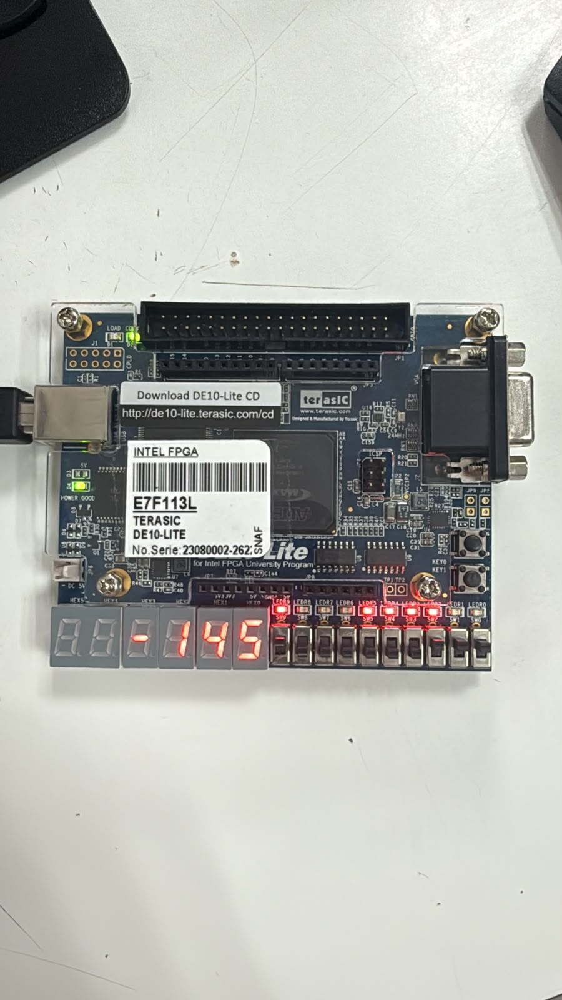
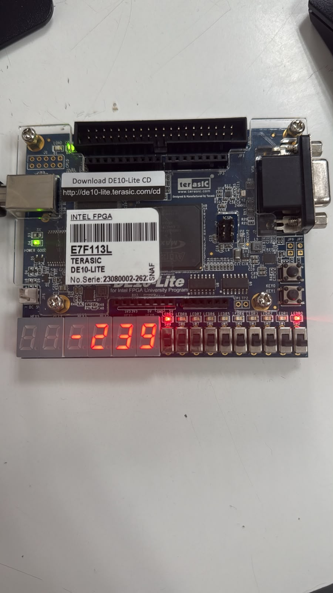
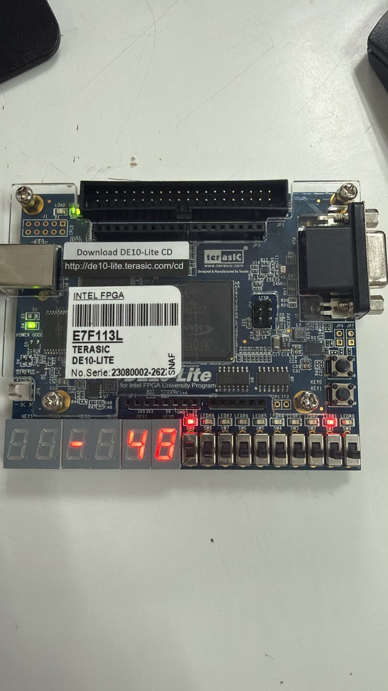
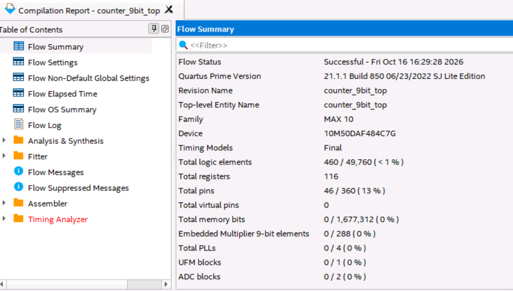

# Reporte de Práctica 3: Contador ascendente-descendente de 9 bits con signo. Intervalo de -256 a 255

**Miguel Ángel Sarmiento Luna · Juan Diego Acosta Ojeda**
Universidad de las Américas Puebla (UDLAP)
Departamento de Computación, Electrónica y Mecatrónica

---

## Resumen

En este reporte se documenta el diseño, la síntesis lógica y la validación experimental de un sistema digital secuencial implementado en lenguaje de descripción de hardware Verilog sobre la FPGA DE10-Lite. El circuito consiste en un contador bidireccional de 9 bits codificado en formato de complemento a dos, capaz de barrer el rango entero comprendido entre $-256$ y $+255$. La arquitectura se divide estratégicamente en una máquina de estados finitos (FSM) encargada de gestionar los modos operativos (retención, incremento y decremento) y un camino de datos síncrono gobernado por pulsos de habilitación (*clock enable*). Asimismo, se integra un decodificador binario a decimal con signo para la visualización en tiempo real mediante cuatro displays de siete segmentos.

## Objetivos

Diseñar e implementar en Verilog un contador ascendente-descendente de 9 bits con signo, capaz de recorrer el intervalo completo representable en complemento a dos, desde -256 hasta 255. El sistema deberá incorporar controles de reinicio, pausa, conteo ascendente y conteo descendente, además de un selector entre dos intervalos de actualización: 1 segundo y 100 milisegundos. El valor actual se mostrará en cuatro displays de 7 segmentos, incluyendo el signo negativo cuando corresponda.

## Marco teórico

### Representación numérica en complemento a dos

Dentro de la aritmética digital, un vector binario de longitud $n = 9$ bits interpretado bajo el convenio de complemento a dos permite modelar cantidades enteras con signo dentro de los límites establecidos por la Ecuación 1 [[1]](#referencias):

$$-2^{n-1} \le X \le 2^{n-1} - 1 \implies -2^8 \le X \le 2^8 - 1 \implies -256 \le X \le 255 \tag{1}$$

El bit ubicado en la posición más significativa (índice 8 del vector) opera como indicador de polaridad: un estado lógico bajo (`0`) denota valores positivos o nulos, mientras que un estado lógico alto (`1`) identifica magnitudes estrictamente negativas.

La Tabla 1 presenta la codificación de valores representativos del contador.

*Tabla 1. Codificación de valores críticos en formato de complemento a dos (9 bits).*

| Magnitud decimal | Vector binario de 9 bits (`val[8:0]`) |
|:--:|:--:|
| $+255$ | `0_1111_1111` |
| $+1$ | `0_0000_0001` |
| $0$ | `0_0000_0000` |
| $-1$ | `1_1111_1111` |
| $-256$ | `1_0000_0000` |

Dado que los sumadores binarios en hardware operan bajo aritmética modular de longitud fija, el desbordamiento en los extremos del intervalo produce una transición cíclica natural sin requerir comparadores adicionales, como se expresa en la Ecuación 2:

$$(+255) + 1 \equiv -256 \pmod{2^9}, \qquad (-256) - 1 \equiv +255 \pmod{2^9} \tag{2}$$

### Partición entre control y ruta de datos

El diseño sigue una metodología estructurada que separa la lógica operativa en dos bloques funcionales [[2]](#referencias):

- **Unidad de control (FSM):** una máquina secuencial de tres estados (`MODO_PAUSA`, `MODO_ASC` y `MODO_DESC`) que evalúa las órdenes provenientes de los pulsadores y define la operación a ejecutar.
- **Ruta de datos (*datapath*):** integrada por el registro acumulador con signo de 9 bits, el preescalador de tiempo y la etapa combinacional de conversión binaria a BCD con decodificación a siete segmentos.

### Dominio único de reloj y pulsos de habilitación

Una regla esencial en el diseño con FPGAs consiste en evitar la división del reloj maestro mediante salidas de contadores conectadas directamente a las entradas de reloj de otros flip-flops, ya que esto introduce sesgos temporales y dificulta el análisis estático de temporización. En su lugar, toda la red secuencial es alimentada por el oscilador principal de $F_{\text{clk}} = 50\text{ MHz}$ de la tarjeta DE10-Lite [[3]](#referencias). Para controlar la cadencia visual del conteo, un temporizador interno genera una bandera activa durante un único periodo de reloj (`pulso_hab`) tras contabilizar $N$ ciclos, calculados mediante la Ecuación 3:

$$N = F_{\text{clk}} \times T_{\text{actualización}} \tag{3}$$

- Para el periodo lento ($T = 1\text{ s}$): $N_{1\text{s}} = (50 \times 10^6\text{ Hz})(1\text{ s}) = 50{,}000{,}000$ ciclos (conteo de $0$ a $49{,}999{,}999$).
- Para el periodo rápido ($T = 100\text{ ms}$): $N_{100\text{ms}} = (50 \times 10^6\text{ Hz})(0.1\text{ s}) = 5{,}000{,}000$ ciclos (conteo de $0$ a $4{,}999{,}999$).

## Planteamiento del experimento

El sistema responde a las entradas de usuario respetando un esquema de jerarquía estricto. En caso de activación simultánea en el mismo ciclo de reloj, el reinicio general (`RST`) domina sobre cualquier otra señal, seguido en orden de prioridad por `PAUSA`, `INC` y finalmente `DEC`.

La Tabla 2 resume las entradas de control del sistema.

*Tabla 2. Descripción operativa de las entradas de control del sistema.*

| Señal de entrada | Respuesta funcional del sistema |
|---|---|
| `RST_N` (prioridad 1) | Limpia el registro acumulador a $0$ y fuerza la FSM al estado `MODO_PAUSA`. |
| `BTN_PAUSA` (prioridad 2) | Congela el valor actual del acumulador y detiene el temporizador de pulsos. |
| `BTN_INC` (prioridad 3) | Transiciona la FSM al estado `MODO_ASC`, sumando $+1$ en cada pulso de habilitación. |
| `BTN_DEC` (prioridad 4) | Transiciona la FSM al estado `MODO_DESC`, restando una unidad en cada pulso de habilitación. |
| `SW_VEL = 0` | Fija la tasa de refresco del contador en $1.0\text{ s}$. |
| `SW_VEL = 1` | Fija la tasa de refresco del contador en $0.1\text{ s}$ ($100\text{ ms}$). |

### Plataforma hardware y herramientas software

La implementación física se realizó en la tarjeta Terasic DE10-Lite, utilizando sus interruptores, pulsadores, LEDs y displays de 7 segmentos. El código Verilog se compiló en Active-HDL. Posteriormente, en Quartus Prime Lite se realizó la síntesis, la asignación de pines y la generación del archivo de programación para configurar la FPGA.

## Códigos Verilog desarrollados

> Los listados corresponden a la versión inicial del diseño, con un solo interruptor de velocidad (`SW_FREQ`). Los archivos de esta carpeta contienen la versión final, con el selector de velocidad de tres interruptores solicitado durante la práctica (ver [Desarrollo y procedimiento de validación](#desarrollo-y-procedimiento-de-validación)). Los módulos [`button_onepulse.v`](button_onepulse.v) y [`tick_generator.v`](tick_generator.v) también se encuentran en esta carpeta.

### Máquina de estados y registro de conteo ([`signed_counter_fsm.v`](signed_counter_fsm.v))

*Listado 1. FSM y lógica secuencial del contador con signo.*

```verilog
module signed_counter_fsm (
    input  wire              clk,
    input  wire              reset,        // activo en alto
    input  wire              tick,
    input  wire              pause_pulse,
    input  wire              inc_pulse,
    input  wire              dec_pulse,
    output reg  signed [8:0] count,
    output reg  [1:0]        state
);

    localparam [1:0] S_PAUSE = 2'd0;
    localparam [1:0] S_UP    = 2'd1;
    localparam [1:0] S_DOWN  = 2'd2;

    reg [1:0] next_state;

    always @(*) begin
        next_state = state;                 // por defecto conserva el estado
        if      (pause_pulse) next_state = S_PAUSE;
        else if (inc_pulse)   next_state = S_UP;
        else if (dec_pulse)   next_state = S_DOWN;
    end

    always @(posedge clk or posedge reset) begin
        if (reset) state <= S_PAUSE;
        else       state <= next_state;
    end

    always @(posedge clk or posedge reset) begin
        if (reset)
            count <= 9'sd0;
        else if (tick && !pause_pulse) begin   // una pausa en el mismo ciclo evita el ultimo cambio
            case (state)
                S_UP:    count <= count + 9'sd1;
                S_DOWN:  count <= count - 9'sd1;
                default: count <= count;
            endcase
        end
    end

endmodule
```

### Decodificador de signo y displays ([`signed_display_9bit.v`](signed_display_9bit.v))

*Listado 2. Conversión numérica a magnitud y control de visores de 7 segmentos.*

```verilog
module signed_display_9bit (
    input  wire signed [8:0] value,
    output wire [6:0]        HEX0,
    output wire [6:0]        HEX1,
    output wire [6:0]        HEX2,
    output wire [6:0]        HEX3
);

    localparam [6:0] SEG_BLANK = 7'b1111111;
    localparam [6:0] SEG_MINUS = 7'b0111111;   // solo segmento g

    function [6:0] seg7;                       // {g,f,e,d,c,b,a}, activo en bajo
        input [3:0] d;
        case (d)
            4'd0:    seg7 = 7'b1000000;
            4'd1:    seg7 = 7'b1111001;
            4'd2:    seg7 = 7'b0100100;
            4'd3:    seg7 = 7'b0110000;
            4'd4:    seg7 = 7'b0011001;
            4'd5:    seg7 = 7'b0010010;
            4'd6:    seg7 = 7'b0000010;
            4'd7:    seg7 = 7'b1111000;
            4'd8:    seg7 = 7'b0000000;
            4'd9:    seg7 = 7'b0010000;
            default: seg7 = SEG_BLANK;
        endcase
    endfunction

    wire       negative  = value[8];
    // Magnitud: para -256 resulta 256, que cabe en 9 bits sin signo
    wire [8:0] magnitude = negative ? (~value + 9'd1) : value;

    wire [3:0] hundreds = magnitude / 9'd100;
    wire [3:0] tens     = (magnitude % 9'd100) / 9'd10;
    wire [3:0] units    = magnitude % 9'd10;

    assign HEX0 = seg7(units);
    assign HEX1 = (hundreds == 4'd0 && tens == 4'd0) ? SEG_BLANK : seg7(tens);
    assign HEX2 = (hundreds == 4'd0)                 ? SEG_BLANK : seg7(hundreds);
    assign HEX3 = negative ? SEG_MINUS : SEG_BLANK;

endmodule
```

### Módulo superior de integración ([`counter_9bit_top.v`](counter_9bit_top.v))

*Listado 3. Top-level con interconexión de periféricos para DE10-Lite.*

```verilog
module counter_9bit_top (
    input  wire       CLOCK_50,
    input  wire       BTN_RESET_N,
    input  wire       BTN_PAUSE_N,
    input  wire       BTN_INC_N,
    input  wire       BTN_DEC_N,
    input  wire       SW_FREQ,
    output wire [6:0] HEX0,
    output wire [6:0] HEX1,
    output wire [6:0] HEX2,
    output wire [6:0] HEX3,
    output wire [9:0] LEDR
);

    localparam [1:0] S_PAUSE = 2'd0;
    localparam [1:0] S_UP    = 2'd1;
    localparam [1:0] S_DOWN  = 2'd2;

    wire reset = ~BTN_RESET_N;
    wire pause_pulse;
    wire inc_pulse;
    wire dec_pulse;
    wire tick;
    wire [1:0] state;
    wire running = (state != S_PAUSE);
    wire signed [8:0] count;

    // Sincronizador para el selector de frecuencia.
    reg speed_meta;
    reg speed_sync;

    always @(posedge CLOCK_50 or posedge reset) begin
        if (reset) begin
            speed_meta <= 1'b0;
            speed_sync <= 1'b0;
        end else begin
            speed_meta <= SW_FREQ;
            speed_sync <= speed_meta;
        end
    end

    button_onepulse u_pause (.clk(CLOCK_50), .reset(reset), .button_n(BTN_PAUSE_N), .press_pulse(pause_pulse));

    button_onepulse u_inc (.clk(CLOCK_50), .reset(reset), .button_n(BTN_INC_N), .press_pulse(inc_pulse));

    button_onepulse u_dec (.clk(CLOCK_50), .reset(reset), .button_n(BTN_DEC_N), .press_pulse(dec_pulse));

    tick_generator u_tick (.clk(CLOCK_50), .reset(reset), .enable(running), .speed_sel(speed_sync), .tick(tick));

    signed_counter_fsm u_counter (.clk(CLOCK_50), .reset(reset), .tick(tick), .pause_pulse(pause_pulse),
                                  .inc_pulse(inc_pulse), .dec_pulse(dec_pulse), .count(count), .state(state));

    signed_display_9bit u_display (.value(count), .HEX0(HEX0), .HEX1(HEX1), .HEX2(HEX2), .HEX3(HEX3));

    // LEDR[0]: pausa, LEDR[1]: ascendente, LEDR[2]: descendente
    // LEDR[3]: 100 ms, LEDR[9]: numero negativo
    assign LEDR = {count[8], 5'b00000, speed_sync, (state == S_DOWN), (state == S_UP), (state == S_PAUSE)};

endmodule
```

### Banco de pruebas de verificación (`TB_signed_counter_fsm.v`)

*Listado 4. Testbench funcional para comprobación de la FSM.*

```verilog
`timescale 1ns/1ps

module TB_signed_counter_fsm;

    reg clk, reset, tick;
    reg pause_pulse, inc_pulse, dec_pulse;
    wire signed [8:0] count;
    wire [1:0] state;   // 0 = PAUSA, 1 = ASCENDENTE, 2 = DESCENDENTE

    signed_counter_fsm DUT (clk, reset, tick, pause_pulse, inc_pulse, dec_pulse, count, state);

    initial clk = 1'b0;
    always #5 clk = ~clk;   // Reloj de 10 ns

    initial begin
        reset = 1; tick = 0; pause_pulse = 0; inc_pulse = 0; dec_pulse = 0; #10;   // RESET: count = 0, PAUSA
        reset = 0; tick = 0; pause_pulse = 0; inc_pulse = 1; dec_pulse = 0; #10;   // INC: pasa a ASCENDENTE
        reset = 0; tick = 1; pause_pulse = 0; inc_pulse = 0; dec_pulse = 0; #10;   // tick: 0 + 1 = 1
        reset = 0; tick = 1; pause_pulse = 0; inc_pulse = 0; dec_pulse = 0; #10;   // tick: 1 + 1 = 2
        reset = 0; tick = 0; pause_pulse = 1; inc_pulse = 0; dec_pulse = 0; #10;   // PAUSA: conserva 2
        reset = 0; tick = 1; pause_pulse = 0; inc_pulse = 0; dec_pulse = 0; #10;   // tick en PAUSA: sigue en 2
        reset = 0; tick = 0; pause_pulse = 0; inc_pulse = 0; dec_pulse = 1; #10;   // DEC: pasa a DESCENDENTE
        reset = 0; tick = 1; pause_pulse = 0; inc_pulse = 0; dec_pulse = 0; #10;   // tick: 2 - 1 = 1
        reset = 0; tick = 1; pause_pulse = 0; inc_pulse = 0; dec_pulse = 0; #10;   // tick: 1 - 1 = 0
        reset = 0; tick = 1; pause_pulse = 0; inc_pulse = 0; dec_pulse = 0; #10;   // tick: 0 - 1 = -1

        DUT.count = 9'sd255;
        reset = 0; tick = 0; pause_pulse = 0; inc_pulse = 1; dec_pulse = 0; #10;   // INC con count = 255
        reset = 0; tick = 1; pause_pulse = 0; inc_pulse = 0; dec_pulse = 0; #10;   // tick: 255 + 1 = -256

        DUT.count = -9'sd256;
        reset = 0; tick = 0; pause_pulse = 0; inc_pulse = 0; dec_pulse = 1; #10;   // DEC con count = -256
        reset = 0; tick = 1; pause_pulse = 0; inc_pulse = 0; dec_pulse = 0; #10;   // tick: -256 - 1 = 255

        reset = 1; tick = 0; pause_pulse = 0; inc_pulse = 0; dec_pulse = 0; #10;   // RESET: count = 0, PAUSA

        $finish;
    end

endmodule
```

## Desarrollo y procedimiento de validación

El sistema se organizó en módulos de acondicionamiento de botones, generación de pulsos de habilitación, control del contador y visualización. La FSM seleccionó el modo de operación y el registro de 9 bits almacenó el valor mostrado en los displays.

Durante la práctica, el profesor solicitó modificar el selector de velocidad para utilizar tres switches. La combinación `000` establece un intervalo nominal de 1 milisegundo y la combinación `111`, uno de 1 segundo. Las combinaciones intermedias seleccionan intervalos proporcionales entre ambos extremos.

La validación consistió en comprobar el reinicio a cero, el conteo en ambos sentidos, la conservación del valor en pausa y las transiciones en los límites del intervalo. También se observaron los cambios de rapidez al modificar el selector y se revisó la utilización de recursos reportada por Quartus Prime.

## Resultados y pruebas experimentales

Las pruebas directas sobre la tarjeta DE10-Lite permitieron comprobar los modos de operación, el reinicio y las transiciones en los límites del contador. La Tabla 3 resume los resultados observados:

*Tabla 3. Matriz de pruebas funcionales en laboratorio.*

| Estado inicial | Acción aplicada | Salida esperada | Estado FSM | Resultado |
|:--:|:--:|:--:|:--:|:--:|
| $0$ | `RESET` activo | $0$ | `S_PAUSE` | Exitoso |
| $0$ | `INC` + 1 `tick` | $1$ | `S_UP` | Exitoso |
| $255$ | 1 `tick` (desborde sup.) | $-256$ | `S_UP` | Exitoso |
| $0$ | `DEC` + 1 `tick` | $-1$ | `S_DOWN` | Exitoso |
| $-256$ | 1 `tick` (desborde inf.) | $255$ | `S_DOWN` | Exitoso |

### Estado inicial y reinicio

La Figura 1 muestra el contador en cero con el indicador de pausa encendido. Esta condición corresponde al estado esperado después del reinicio.

<p align="center">
  
  <br>
  <em>Figura 1. Estado inicial del contador en cero y pausa.</em>
</p>

Al aplicar el reinicio, el contador regresó a cero y quedó en pausa, como se muestra en la Figura 2.

<p align="center">
  
  <br>
  <em>Figura 2. Lectura de cero durante la prueba de reinicio.</em>
</p>

### Conteo ascendente y descendente

Durante la prueba de conteo ascendente se observó el aumento del valor mostrado con un intervalo nominal de 1 segundo. La Figura 3 registra una lectura de $124$ con el indicador del modo ascendente encendido.

<p align="center">
  
  <br>
  <em>Figura 3. Conteo ascendente con intervalo nominal de 1 segundo.</em>
</p>

En el modo descendente se comprobó la disminución del contador y la visualización de valores negativos. La Figura 4 muestra una lectura de $-145$, con los indicadores de modo descendente y signo negativo encendidos.

<p align="center">
  
  <br>
  <em>Figura 4. Conteo descendente con lectura de −145.</em>
</p>

### Pausa

Al activar la pausa, el contador conservó el valor mostrado durante la observación. La Figura 5 registra una lectura de $-239$ con el indicador de pausa encendido.

<p align="center">
  
  <br>
  <em>Figura 5. Contador en pausa con lectura de −239.</em>
</p>

### Conteo con intervalo de 1 milisegundo

En la versión modificada, al seleccionar `000` se observó un conteo más rápido que con el intervalo de 1 segundo. La Figura 6 muestra una lectura de $-48$ con el indicador de modo ascendente encendido.

El signo negativo no contradice el sentido ascendente: el contador también recorre los valores negativos y continúa desde $-256$ después de superar $255$.

<p align="center">
  
  <br>
  <em>Figura 6. Modo ascendente con intervalo nominal de 1 milisegundo.</em>
</p>

### Pruebas en los límites del intervalo

Se comprobó en la tarjeta que, al incrementar $255$, el contador pasó a $-256$ y que, al decrementar $-256$, pasó a $255$. Ambos resultados coincidieron con el comportamiento modular esperado para 9 bits en complemento a dos. Estas transiciones se observaron durante la práctica, aunque no se cuenta con fotografías de esos instantes.

### Utilización de recursos

La Figura 7 presenta el resumen de compilación generado por Quartus Prime Lite. El diseño utilizó 460 de los 49 760 elementos lógicos disponibles (menos del 1 %), 116 registros y 46 de los 360 pines disponibles (13 %). No se utilizaron bits de memoria, multiplicadores dedicados ni PLLs.

<p align="center">
  
  <br>
  <em>Figura 7. Resumen de compilación y utilización de recursos en Quartus Prime Lite.</em>
</p>

Estos resultados muestran que la versión compilada ocupa una proporción reducida de los recursos lógicos de la FPGA.

## Análisis de resultados

Los resultados obtenidos en la tarjeta fueron consistentes con el funcionamiento esperado del contador. Las pruebas de conteo ascendente y descendente permitieron comprobar la actualización del valor en ambos sentidos, mientras que la pausa conservó la lectura y el reinicio colocó el contador en cero y detuvo el conteo.

La visualización de valores positivos y negativos mostró que la conversión a decimal y la presentación del signo funcionaron de manera coherente con la representación en complemento a dos. En particular, una lectura negativa durante el modo ascendente es válida, pues el sentido del conteo determina la operación realizada y no el signo del valor almacenado.

Las transiciones observadas de $255$ a $-256$ y de $-256$ a $255$ coincidieron con el comportamiento modular de un registro de 9 bits. Por tanto, al superar alguno de los extremos, el contador continuó desde el extremo opuesto en lugar de detenerse o conservar el valor límite.

La modificación del selector permitió observar una diferencia de rapidez entre los intervalos nominales de 1 segundo y 1 milisegundo. Ambos modos conservaron la misma lógica de conteo, ya que únicamente se modificó la separación entre pulsos de habilitación. Esta comparación fue cualitativa, sin una medición instrumental de los intervalos.

Finalmente, el resumen de Quartus mostró una utilización inferior al 1 % de los elementos lógicos disponibles, sin emplear memoria dedicada, multiplicadores dedicados ni PLLs. Esto indica que la versión compilada pudo implementarse utilizando una proporción reducida de los recursos de la FPGA. La comparación de resultados se sustenta en el comportamiento teórico y las pruebas en la tarjeta, al no contar con capturas de simulación.

## Cuestionario

1. **¿Por qué un número con signo de 9 bits representa valores desde $-256$ hasta $255$ y no desde $-255$ hasta $255$?**
   Los 9 bits permiten representar $2^9=512$ combinaciones. En complemento a dos, 256 corresponden a valores negativos y las otras 256 al cero y los valores positivos. Por ello, el intervalo es de $-256$ a $255$.

2. **¿Qué patrón binario representa $-256$ en complemento a dos de 9 bits?**
   El patrón es `1_0000_0000`, porque el bit más significativo tiene un peso de $-256$ y los demás bits son cero.

3. **¿Qué ocurre al incrementar $255$ y al decrementar $-256$?**
   Al incrementar $255$ se obtiene $-256$ y al decrementar $-256$ se obtiene $255$. Esto ocurre por el comportamiento modular de la aritmética de 9 bits.

4. **¿Qué diferencia existe entre generar un reloj nuevo y generar un pulso de habilitación?**
   Un reloj nuevo utiliza sus propios flancos para actualizar registros y puede introducir otro dominio de reloj. Un pulso de habilitación indica cuándo actualizar los registros, conservando el reloj principal como referencia temporal.

5. **¿Por qué deben sincronizarse las entradas de los botones?**
   Porque son entradas asíncronas y pueden cambiar cerca de un flanco del reloj. Un sincronizador reduce la probabilidad de que la metaestabilidad se propague a la lógica del sistema.

6. **¿Qué problema evita el circuito antirrebote?**
   Evita que las transiciones rápidas del contacto mecánico se interpreten como varias pulsaciones cuando el usuario realiza una sola activación.

7. **¿Cuántos ciclos de $50\,\text{MHz}$ corresponden a $100\,\text{ms}$?**
   Corresponden a $5\,000\,000$ ciclos, obtenidos mediante $(50\times10^6)(0.1)$. Si el temporizador cuenta desde cero, su valor terminal es $4\,999\,999$.

8. **¿Qué recursos adicionales pueden requerir los operadores de división y módulo durante la síntesis?**
   Pueden requerir lógica combinacional adicional para calcular cocientes y residuos, aumentando la utilización de elementos lógicos y el retardo del circuito. El costo depende del ancho de los operandos y de las optimizaciones del sintetizador; cuando los divisores son constantes, la herramienta puede simplificar las operaciones.

## Conclusiones

La práctica permitió implementar un contador de 9 bits con signo y comprobar en la tarjeta el conteo ascendente y descendente, la pausa y el reinicio a cero. Las transiciones de $255$ a $-256$ y de $-256$ a $255$ confirmaron el comportamiento modular de la representación en complemento a dos. La separación entre control y ruta de datos facilitó la integración del conteo y la visualización, mientras que los pulsos de habilitación permitieron ajustar la velocidad manteniendo un único dominio de reloj. Además, la modificación solicitada por el profesor amplió la selección de intervalos entre 1 milisegundo y 1 segundo.

## Referencias

1. M. M. Mano y M. D. Ciletti, *Digital Design: With an Introduction to the Verilog HDL, VHDL, and SystemVerilog*, 6.ª ed., Pearson, 2018.
2. S. Brown y Z. Vranesic, *Fundamentals of Digital Logic with Verilog Design*, 3.ª ed., McGraw-Hill, 2014.
3. Terasic Inc., *DE10-Lite User Manual*, 2016.
