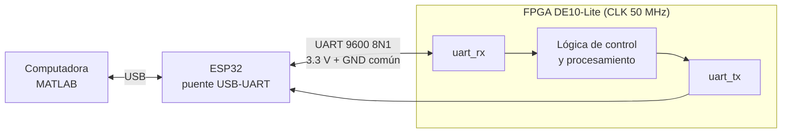
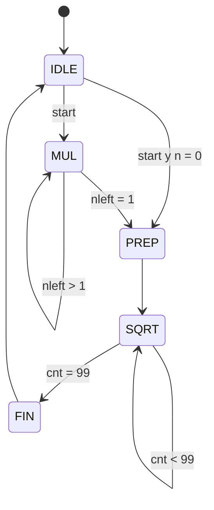
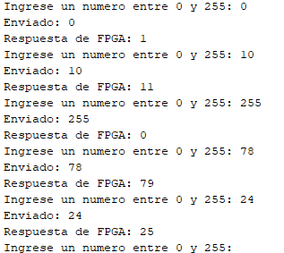

# Reporte de Práctica 4: Comunicación bidireccional UART entre FPGA DE10-Lite y computadora usando MATLAB y ESP32

**Miguel Ángel Sarmiento Luna · Juan Diego Acosta Ojeda**
Universidad de las Américas Puebla (UDLAP)
Departamento de Computación, Electrónica y Mecatrónica

---

## Resumen

En esta práctica se diseña e implementa un sistema de comunicación serial bidireccional entre una FPGA DE10-Lite y una computadora mediante el protocolo UART a 9600 baudios en formato 8N1. La computadora se comunica con la FPGA a través de MATLAB, y un módulo ESP32 actúa como puente USB-UART transparente. Se desarrollaron dos versiones del procesamiento en la FPGA: en la **Parte A** la FPGA devuelve el byte recibido más uno, y en la **Parte B** calcula $A^{n/2}$ en punto fijo Q80.20, con $A$ y $n$ enviados desde MATLAB. Ambas partes se validaron en simulación y en la tarjeta.

## Objetivos

Diseñar e implementar un sistema de comunicación serial bidireccional entre una FPGA DE10-Lite y una computadora mediante protocolo UART. La computadora utilizará scripts en MATLAB para enviar y recibir datos, mientras que un módulo ESP32 funcionará como puente USB-UART entre la PC y la FPGA. La FPGA transmitirá, recibirá y procesará la información serial.

## Marco teórico

### Comunicación serial UART

UART (*Universal Asynchronous Receiver Transmitter*) es un método de comunicación serial asíncrona en el cual no se comparte una señal de reloj entre transmisor y receptor. En su lugar, ambos dispositivos deben configurarse con la misma velocidad de transmisión o *baud rate* [[1]](#referencias). Una trama UART típica contiene un bit de inicio, 8 bits de datos, opcionalmente un bit de paridad y uno o más bits de paro. En esta práctica se utiliza la configuración **9600 baudios; 8 bits de datos; sin paridad; 1 bit de paro (8N1)**.

### Comunicación bidireccional

La comunicación bidireccional permite que ambos dispositivos transmitan y reciban información. Para ello se utilizan dos líneas: TX (transmisión) y RX (recepción). La conexión debe realizarse de forma cruzada: el TX de un dispositivo se conecta al RX del otro, y ambos comparten una tierra común.

### Uso del ESP32 como puente USB-UART

La computadora establece un puerto serial virtual con el ESP32 a través de su puerto USB. Internamente, el ESP32 recibe los bytes de la PC y los retransmite por una UART de hardware hacia la FPGA; los datos que la FPGA transmite siguen el camino inverso. De esta manera, el ESP32 reemplaza al convertidor USB a UART TTL externo. Tanto el ESP32 como la FPGA operan con niveles lógicos de 3.3 V, por lo que no se requieren convertidores de nivel. El protocolo RS232 clásico, en cambio, utiliza niveles de voltaje distintos y no debe conectarse directamente a la FPGA.

### Cálculo del divisor de baudios

Con un reloj de 50 MHz y una velocidad de 9600 baudios, el número de ciclos de reloj por bit es:

$$N = \frac{50000000}{9600} \approx 5208 \qquad (1)$$

Este valor se utiliza para generar la duración de cada bit transmitido y para muestrear los bits recibidos. Al truncar a 5208 ciclos, la velocidad real es $50\,000\,000 / 5208 \approx 9600.6$ baudios, una diferencia de aproximadamente 0.006 % que no afecta la comunicación.

### Punto fijo Q80.20 y raíz cuadrada entera

Un número en formato Q80.20 utiliza 100 bits: 80 para la parte entera y 20 para la parte fraccionaria, de modo que el valor almacenado $V$ representa el número real $V / 2^{20}$. Para la Parte B se requiere $A^{n/2}$, que puede escribirse como la raíz cuadrada de $A^n$. Como $\sqrt{2^{40}} = 2^{20}$, la raíz entera de $A^n \cdot 2^{40}$ entrega directamente el resultado escalado:

$$\left\lfloor \sqrt{A^n \cdot 2^{40}} \right\rfloor = \left\lfloor A^{n/2} \cdot 2^{20} \right\rfloor \qquad (2)$$

El resultado es el piso (truncado) del valor real, con una resolución de $2^{-20} \approx 0.00000095$. El valor $A^n$ se obtiene con $n$ multiplicaciones sucesivas y la raíz entera con un algoritmo de un bit por ciclo de reloj.

Se limita $n \leq 20$ por el tamaño de los registros: $255^{10} \approx 2^{79.94}$ es lo máximo que cabe en los 80 bits de parte entera, y el registro de 160 bits para $A^n$ solo alcanza para $255^{20}$.

## Planteamiento del experimento

### Plataforma hardware y herramientas software

- **FPGA Terasic DE10-Lite** (Intel MAX 10 `10M50DAF484C7G`), reloj de 50 MHz.
- **ESP32** programado en Arduino IDE como puente serial.
- **MATLAB**, con el objeto `serialport`, para enviar y recibir datos.
- **Quartus Prime Lite** para síntesis y programación, e **Icarus Verilog** para simulación.
- Cables Dupont y cable USB para el ESP32.

### Esquema de bloques del sistema



*Figura 1. Arquitectura del sistema: PC ↔ USB ↔ ESP32 ↔ UART ↔ FPGA.*

### Conexiones y asignación de pines

*Tabla 1. Conexión física entre el ESP32 y la FPGA.*

| ESP32 | DE10-Lite (header GPIO) |
|:--:|:--:|
| GPIO17 (TX) | GPIO[0], `UART_RX` (PIN_V10) |
| GPIO16 (RX) | GPIO[1], `UART_TX` (PIN_W10) |
| GND | GND del header |

*Tabla 2. Asignación de pines en Quartus Prime.*

| Señal | Pin | I/O Standard |
|:--:|:--:|:--:|
| `CLOCK_50` | PIN_P11 | 3.3-V LVTTL |
| `RESET_N` | PIN_B8 (KEY0) | 3.3-V LVTTL |
| `UART_RX` | PIN_V10 | 3.3-V LVTTL |
| `UART_TX` | PIN_W10 | 3.3-V LVTTL |

El ESP32 se alimenta únicamente por USB, sin pines de 5 V, y el Monitor Serial de Arduino debe cerrarse antes de usar MATLAB para que el puerto COM esté libre.

### Especificaciones del diseño

1. La FPGA recibe datos seriales desde la computadora a través del ESP32 y transmite datos seriales hacia la computadora por el mismo camino.
2. Velocidad de 9600 baudios, formato 8N1.
3. La FPGA procesa los bytes recibidos: **Parte A**, devuelve el byte recibido más 1; **Parte B**, devuelve $A^{n/2}$ en Q80.20.
4. La computadora cuenta con un script de MATLAB que envía datos a la FPGA y muestra su respuesta.
5. El ESP32 funciona como puente transparente.

## Problemas encontrados y correcciones

Durante las pruebas del código base se encontraron los errores de la Tabla 3. Los errores 1 a 3 son en realidad uno solo: el receptor guardaba el **bit de inicio como si fuera dato**. Al muestrear a mitad de bit, la primera muestra cae en el bit de inicio (siempre 0); el código original la guardaba en `rx_shift[0]`, desplazaba todos los bits una posición y perdía el bit 7. Enviar 10 (`00001010`) se recibía como 20 y la FPGA devolvía 21 en lugar de 11.

*Tabla 3. Errores del código original y su corrección.*

| # | Archivo | Error | Corrección | ¿Obligatorio? |
|:--:|---|---|---|:--:|
| 1 | `uart_rx.v` | `reg [7:0] rx_shift` | `reg [8:0] rx_shift` | Sí |
| 2 | `uart_rx.v` | `if (bit_index < 8)` | `if (bit_index < 9)` | Sí |
| 3 | `uart_rx.v` | `data_out <= rx_shift;` | `data_out <= rx_shift[8:1];` | Sí |
| 4 | ESP32 | `Serial.println("ESP32 listo...")` | Borrar la línea | Sí |
| 5 | MATLAB | Sin `flush(s)` tras `pause(2)` | Agregar `flush(s);` | Recomendable |

Líneas afectadas del código original:

```verilog
    reg [7:0]  rx_shift;          // ERROR 1: solo 8 bits, no hay lugar para el bit de inicio
    ...
                    if (bit_index < 8) begin             // ERROR 2: solo 8 muestras, la 1a es el inicio
                        rx_shift[bit_index] <= rx;       // el inicio se guarda como dato y el bit 7 se pierde
    ...
                        data_out   <= rx_shift;          // ERROR 3: entrega el dato corrido un lugar
```

El `println` de arranque del ESP32 (error 4) hacía que MATLAB leyera los caracteres del texto como si fueran la respuesta de la FPGA; el primero es la `E`, con valor 69. Por eso el puente debe ser transparente y no enviar texto propio.

## Códigos desarrollados

### Archivos comunes a las dos partes

Todos los archivos de este reporte están en las carpetas [`parte_a/`](parte_a/) y [`parte_b/`](parte_b/); cada una contiene todo lo necesario para compilar su versión en Quartus (los archivos comunes están repetidos en ambas).

#### Receptor UART (`uart_rx.v`, corregido)

*Listado 1. Receptor UART corregido.*

```verilog
module uart_rx #(
    parameter CLK_FREQ  = 50000000,
    parameter BAUD_RATE = 9600
)(
    input  wire       clk,
    input  wire       reset,
    input  wire       rx,
    output reg  [7:0] data_out,
    output reg        data_valid
);
    localparam integer CLKS_PER_BIT = CLK_FREQ / BAUD_RATE;
    localparam integer HALF_BIT     = CLKS_PER_BIT / 2;

    reg [15:0] clk_count;
    reg [3:0]  bit_index;
    reg [8:0]  rx_shift;        // CORREGIDO: 9 bits (inicio + 8 datos)
    reg        receiving;

    always @(posedge clk or posedge reset) begin
        if (reset) begin
            clk_count <= 0; bit_index <= 0; rx_shift <= 0;
            receiving <= 1'b0; data_out <= 8'd0; data_valid <= 1'b0;
        end else begin
            data_valid <= 1'b0;
            if (!receiving) begin
                if (rx == 1'b0) begin
                    receiving <= 1'b1;
                    clk_count <= HALF_BIT;
                    bit_index <= 0;
                end
            end else begin
                if (clk_count < CLKS_PER_BIT - 1) begin
                    clk_count <= clk_count + 1;
                end else begin
                    clk_count <= 0;
                    if (bit_index < 9) begin            // CORREGIDO
                        rx_shift[bit_index] <= rx;
                        bit_index <= bit_index + 1;
                    end else begin
                        receiving  <= 1'b0;
                        data_out   <= rx_shift[8:1];    // CORREGIDO
                        data_valid <= 1'b1;
                    end
                end
            end
        end
    end
endmodule
```

#### Transmisor UART (`uart_tx.v`, sin cambios)

*Listado 2. Transmisor UART.*

```verilog
module uart_tx #(
    parameter CLK_FREQ  = 50000000,
    parameter BAUD_RATE = 9600
)(
    input  wire       clk,
    input  wire       reset,
    input  wire       tx_start,
    input  wire [7:0] data_in,
    output reg        tx,
    output reg        busy
);
    localparam integer CLKS_PER_BIT = CLK_FREQ / BAUD_RATE;
    reg [15:0] clk_count;
    reg [3:0]  bit_index;
    reg [9:0]  tx_shift;

    always @(posedge clk or posedge reset) begin
        if (reset) begin
            tx <= 1'b1; busy <= 1'b0; clk_count <= 0; bit_index <= 0;
            tx_shift <= 10'b1111111111;
        end else begin
            if (!busy) begin
                tx <= 1'b1;
                if (tx_start) begin
                    busy <= 1'b1;
                    tx_shift <= {1'b1, data_in, 1'b0};   // paro, dato, inicio
                    clk_count <= 0; bit_index <= 0;
                end
            end else begin
                tx <= tx_shift[0];
                if (clk_count < CLKS_PER_BIT - 1) begin
                    clk_count <= clk_count + 1;
                end else begin
                    clk_count <= 0;
                    tx_shift  <= {1'b1, tx_shift[9:1]};
                    if (bit_index < 9) bit_index <= bit_index + 1;
                    else begin busy <= 1'b0; tx <= 1'b1; end
                end
            end
        end
    end
endmodule
```

#### Puente en el ESP32 (`puente_uart.ino`)

*Listado 3. Programa del ESP32 en Arduino IDE.*

```cpp
#include <Arduino.h>

static const int FPGA_RX_PIN = 16;   // RX del ESP32 <- TX de la FPGA
static const int FPGA_TX_PIN = 17;   // TX del ESP32 -> RX de la FPGA

static const uint32_t PC_BAUD   = 9600;
static const uint32_t FPGA_BAUD = 9600;

HardwareSerial FPGA_Serial(2);

void setup() {
  Serial.begin(PC_BAUD);
  delay(500);
  FPGA_Serial.begin(FPGA_BAUD, SERIAL_8N1, FPGA_RX_PIN, FPGA_TX_PIN);
  // Se eliminó Serial.println("ESP32 listo..."): el puente debe ser transparente
}

void loop() {
  while (Serial.available()) {
    uint8_t dato = (uint8_t)Serial.read();
    FPGA_Serial.write(dato);
  }
  while (FPGA_Serial.available()) {
    uint8_t dato = (uint8_t)FPGA_Serial.read();
    Serial.write(dato);
  }
}
```

El programa inicializa dos interfaces seriales: `Serial`, para la comunicación entre la computadora y el ESP32 por USB, y `FPGA_Serial` (UART2), para la comunicación entre el ESP32 y la FPGA. Todo byte recibido por una se reenvía por la otra.

### Parte A: la FPGA suma 1

#### Módulo superior (`top_uart_de10lite.v`)

*Listado 4. Módulo superior de la Parte A.*

```verilog
module top_uart_de10lite #(
    parameter CLK_FREQ  = 50000000,
    parameter BAUD_RATE = 9600
)(
    input  wire CLOCK_50,
    input  wire RESET_N,
    input  wire UART_RX,
    output wire UART_TX
);

    wire reset;
    assign reset = ~RESET_N;

    wire [7:0] rx_data;
    wire       rx_done;
    reg  [7:0] tx_data;
    reg        tx_start;
    wire       tx_busy;

    uart_rx #(.CLK_FREQ(CLK_FREQ), .BAUD_RATE(BAUD_RATE)) RX0 (
        .clk(CLOCK_50), .reset(reset), .rx(UART_RX),
        .data_out(rx_data), .data_valid(rx_done)
    );

    uart_tx #(.CLK_FREQ(CLK_FREQ), .BAUD_RATE(BAUD_RATE)) TX0 (
        .clk(CLOCK_50), .reset(reset), .tx_start(tx_start),
        .data_in(tx_data), .tx(UART_TX), .busy(tx_busy)
    );

    always @(posedge CLOCK_50 or posedge reset) begin
        if (reset) begin
            tx_data  <= 8'd0;
            tx_start <= 1'b0;
        end else begin
            tx_start <= 1'b0;
            if (rx_done && !tx_busy) begin
                tx_data  <= rx_data + 8'd1;   // la FPGA suma 1
                tx_start <= 1'b1;
            end
        end
    end

endmodule
```

#### Script de MATLAB

*Listado 5. Comunicación bidireccional (`bidireccional.m`).*

```matlab
clear
clc

PORT = "COM3";   % Cambiar por el puerto del ESP32
BAUD = 9600;

s = serialport(PORT, BAUD);
pause(2);
flush(s);        % descarta bytes basura del reinicio del ESP32

disp("Comunicacion bidireccional iniciada");
disp("La FPGA regresara el byte recibido mas 1");

while true
    valor = input('Ingrese un numero entre 0 y 255: ');
    if valor < 0 || valor > 255
        disp('Valor fuera de rango');
        continue;
    end

    write(s, uint8(valor), "uint8");
    disp(['Enviado: ', num2str(valor)]);
    pause(0.1);

    if s.NumBytesAvailable > 0
        respuesta = read(s, 1, "uint8");
        disp(['Respuesta de FPGA: ', num2str(double(respuesta))]);
    else
        disp('No se recibio respuesta');
    end
end
```

#### Banco de pruebas ([`parte_a/tb_top_uart.v`](parte_a/tb_top_uart.v))

El testbench envía al módulo superior los bytes 10, 100 y 255 con la temporización de 5208 ciclos por bit y observa la respuesta de `UART_TX`.

### Parte B: la FPGA calcula $A^{n/2}$ en Q80.20

**Protocolo.** MATLAB envía 2 bytes `[A][n]` ($A$ de 0 a 255, $n$ de 0 a 20). La FPGA responde con 13 bytes, MSB primero: 4 ceros de relleno seguidos de los 100 bits del valor Q80.20. Los módulos `uart_rx.v`, `uart_tx.v` y `puente_uart.ino` son los mismos de la sección anterior; el módulo superior reemplaza al de la Parte A.

#### Módulo de cálculo (`pow_half_q20.v`)

*Listado 6. Cálculo de $A^{n/2}$ en Q80.20.*

```verilog
// result = floor( A^(n/2) * 2^20 )  en Q80.20 (100 bits)   A: 0..255, n: 0..20
module pow_half_q20 (
    input  wire         clk,
    input  wire         rst,
    input  wire         start,
    input  wire [7:0]   a,
    input  wire [7:0]   n,
    output reg          done,
    output reg  [99:0]  result
);
    localparam IDLE = 3'd0, MUL = 3'd1, PREP = 3'd2, SQRT = 3'd3, FIN = 3'd4;

    reg [2:0]   state;
    reg [7:0]   a_r;
    reg [4:0]   nleft;
    reg [159:0] p;          // A^k
    reg [199:0] rad;        // A^n * 2^40
    reg [103:0] rem;
    reg [99:0]  res;
    reg [6:0]   cnt;

    wire [103:0] rem_n = {rem[101:0], rad[199:198]};
    wire [103:0] trial = {2'b00, res, 2'b01};

    always @(posedge clk or posedge rst) begin
        if (rst) begin
            state <= IDLE; done <= 1'b0; result <= 0;
            a_r <= 0; nleft <= 0; p <= 0; rad <= 0; rem <= 0; res <= 0; cnt <= 0;
        end else begin
            done <= 1'b0;
            case (state)
                IDLE: if (start) begin
                    a_r   <= a;
                    nleft <= n[4:0];
                    p     <= 160'd1;
                    state <= (n == 8'd0) ? PREP : MUL;
                end

                MUL: begin                       // p = p * A, n veces
                    p     <= p * a_r;
                    nleft <= nleft - 1'b1;
                    if (nleft == 5'd1) state <= PREP;
                end

                PREP: begin
                    rad <= {p, 40'd0};
                    rem <= 0; res <= 0; cnt <= 0;
                    state <= SQRT;
                end

                SQRT: begin                      // raíz entera, 100 iteraciones
                    if (rem_n >= trial) begin
                        rem <= rem_n - trial;
                        res <= {res[98:0], 1'b1};
                    end else begin
                        rem <= rem_n;
                        res <= {res[98:0], 1'b0};
                    end
                    rad <= {rad[197:0], 2'b00};
                    cnt <= cnt + 1'b1;
                    if (cnt == 7'd99) state <= FIN;
                end

                FIN: begin
                    result <= res;
                    done   <= 1'b1;
                    state  <= IDLE;
                end

                default: state <= IDLE;
            endcase
        end
    end
endmodule
```

La máquina de estados del módulo es la siguiente:



*Figura 2. Máquina de estados de `pow_half_q20`.*

*Tabla 4. Estados de `pow_half_q20`.*

| Estado | Qué hace | Ciclos |
|---|---|:--:|
| `IDLE` | Espera `start`; si $n = 0$ salta a `PREP` | — |
| `MUL` | `p = p * A` | $n$ |
| `PREP` | `rad = p << 40`; limpia `rem`, `res` y `cnt` | 1 |
| `SQRT` | Calcula un bit de la raíz por ciclo | 100 |
| `FIN` | `result = res`; `done = 1` | 1 |

#### Módulo superior (`top_uart_de10lite.v`, Parte B)

*Listado 7. Módulo superior de la Parte B.*

```verilog
// PC envía [A][n]  ->  FPGA responde 13 bytes (MSB primero): A^(n/2) en Q80.20
// (100 bits, con 4 ceros de relleno arriba = 104 bits). MATLAB valida n <= 20.
module top_uart_de10lite #(
    parameter CLK_FREQ  = 50000000,
    parameter BAUD_RATE = 9600
)(
    input  wire CLOCK_50,
    input  wire RESET_N,
    input  wire UART_RX,
    output wire UART_TX
);
    wire reset = ~RESET_N;

    wire [7:0] rx_data;
    wire       rx_done;
    reg  [7:0] tx_data;
    reg        tx_start;
    wire       tx_busy;

    reg         calc_start;
    wire        calc_done;
    wire [99:0] calc_result;
    reg  [7:0]  a_reg, n_reg;

    uart_rx #(.CLK_FREQ(CLK_FREQ), .BAUD_RATE(BAUD_RATE)) RX0 (
        .clk(CLOCK_50), .reset(reset), .rx(UART_RX),
        .data_out(rx_data), .data_valid(rx_done));

    uart_tx #(.CLK_FREQ(CLK_FREQ), .BAUD_RATE(BAUD_RATE)) TX0 (
        .clk(CLOCK_50), .reset(reset), .tx_start(tx_start),
        .data_in(tx_data), .tx(UART_TX), .busy(tx_busy));

    pow_half_q20 POW0 (
        .clk(CLOCK_50), .rst(reset), .start(calc_start),
        .a(a_reg), .n(n_reg), .done(calc_done), .result(calc_result));

    localparam S_A = 3'd0, S_N = 3'd1, S_CALC = 3'd2,
               S_LOAD = 3'd3, S_WAIT = 3'd4, S_BUSY = 3'd5;

    reg [2:0]   state;
    reg [3:0]   idx;
    reg [103:0] res_sh;

    always @(posedge CLOCK_50 or posedge reset) begin
        if (reset) begin
            state <= S_A; idx <= 0; res_sh <= 0;
            tx_data <= 0; tx_start <= 0; calc_start <= 0;
            a_reg <= 0; n_reg <= 0;
        end else begin
            tx_start   <= 1'b0;
            calc_start <= 1'b0;
            case (state)
                S_A: if (rx_done) begin
                    a_reg <= rx_data;
                    state <= S_N;
                end

                S_N: if (rx_done) begin
                    n_reg      <= rx_data;
                    calc_start <= 1'b1;
                    state      <= S_CALC;
                end

                S_CALC: if (calc_done) begin
                    res_sh <= {4'd0, calc_result};
                    idx    <= 0;
                    state  <= S_LOAD;
                end

                S_LOAD: begin
                    tx_data  <= res_sh[103:96];      // MSB primero
                    tx_start <= 1'b1;
                    state    <= S_WAIT;
                end

                S_WAIT: state <= S_BUSY;

                S_BUSY: if (!tx_busy) begin
                    if (idx == 4'd12) state <= S_A;
                    else begin
                        res_sh <= {res_sh[95:0], 8'd0};
                        idx    <= idx + 1;
                        state  <= S_LOAD;
                    end
                end

                default: state <= S_A;
            endcase
        end
    end
endmodule
```

#### Script de MATLAB (`bidireccional_q20.m`)

*Listado 8. Cliente MATLAB para la Parte B.*

```matlab
clear
clc

PORT = "COM3";   % Cambiar por el puerto del ESP32
BAUD = 9600;

s = serialport(PORT, BAUD);
s.Timeout = 2;
pause(2);
flush(s);

disp("Calcula A^(n/2) en Q80.20 (A: 0..255, n: 0..20). 'q' para salir.");

while true
    eA = input('A (0-255): ', 's');
    if strcmpi(eA, 'q'), break; end
    en = input('n (0-20): ', 's');
    if strcmpi(en, 'q'), break; end
    A = str2double(eA);  n = str2double(en);

    if isnan(A) || isnan(n) || A ~= round(A) || n ~= round(n) || A < 0 || A > 255 || n < 0 || n > 20
        disp('Valores invalidos: A entero 0..255, n entero 0..20');
        continue;
    end

    flush(s);
    write(s, uint8([A n]), "uint8");        % primero A, luego n

    t0 = tic;
    while s.NumBytesAvailable < 13 && toc(t0) < 2
        pause(0.005);
    end
    if s.NumBytesAvailable < 13
        disp('No se recibio respuesta completa (13 bytes)');
        continue;
    end

    b = read(s, 13, "uint8");               % MSB primero
    if b(1) == 255
        disp('La FPGA reporto error (n fuera de rango)');
        continue;
    end

    bits = reshape(dec2bin(b, 8).', 1, []); % 104 bits
    bits = bits(5:end);                     % quita 4 ceros de relleno -> 100 bits
    parteEntera = bits(1:80);
    parteFrac   = bits(81:100);

    fprintf('Q80.20 : %s.%s\n', parteEntera, parteFrac);
end

clear s
```

## Resultados

### Parte A: simulación

La Parte A se simuló con Icarus Verilog con el banco de pruebas [`tb_top_uart.v`](parte_a/tb_top_uart.v) y los casos de la Tabla 5, los cuales coincidieron con la respuesta esperada. No se cuenta con capturas de las formas de onda.

### Parte A: pruebas en la tarjeta

La Figura 3 muestra la consola de MATLAB con el script `bidireccional.m` durante la prueba en la tarjeta. En cada caso se envió un número y la FPGA respondió con el valor siguiente, incluido el caso límite $255 \rightarrow 0$.

<p align="center">
  
  <br>
  <em>Figura 3. Consola de MATLAB: el dato enviado y la respuesta de la FPGA (+1).</em>
</p>

*Tabla 5. Comparación entre resultados esperados y obtenidos (Parte A).*

| Dato enviado | Respuesta esperada | Respuesta en consola (Figura 3) | Simulación | Descripción |
|:--:|:--:|:--:|:--:|---|
| 0 | 1 | 1 | — | Incremento en 1 |
| 10 | 11 | 11 | Correcta | Incremento en 1 |
| 24 | 25 | 25 | — | Incremento en 1 |
| 25 | 26 | — | Correcta | Incremento en 1 |
| 78 | 79 | 79 | — | Incremento en 1 |
| 100 | 101 | — | Correcta | Incremento en 1 |
| 200 | 201 | — | Correcta | Incremento en 1 |
| 255 | 0 | 0 | Correcta | Caso límite: desborda a 0 |

El guion (—) indica que ese valor no se probó por ese medio.

### Parte B: simulación

La Parte B se simuló con Icarus Verilog y se comparó bit a bit contra la raíz entera exacta calculada en Python. Se aprobaron los 43 casos probados. No se cuenta con capturas de la simulación.

### Parte B: pruebas en la tarjeta

La Parte B también se probó físicamente con la FPGA, el ESP32 y el script `bidireccional_q20.m`, y funcionó correctamente: la FPGA devolvió el valor $A^{n/2}$ en Q80.20 para los valores de $A$ y $n$ enviados desde MATLAB. No se cuenta con una captura de la consola de estas pruebas.

El tiempo de cálculo en la FPGA es de aproximadamente $n + 102$ ciclos de reloj, es decir, unos 2 µs a 50 MHz. La respuesta completa tarda mucho más en transmitirse: 13 bytes de 10 bits cada uno a 9600 baudios equivalen a $130 / 9600 \approx 13.5$ ms. El cuello de botella es, por tanto, el enlace serial y no el cálculo.

## Análisis de resultados

Las pruebas de la Parte A en la tarjeta coincidieron con el comportamiento esperado: la FPGA recibió cada byte enviado desde MATLAB a través del ESP32 y devolvió su valor incrementado en uno, con el caso límite $255 \rightarrow 0$ por la aritmética de 8 bits. Esto confirma que el enlace funciona en ambos sentidos con 9600 baudios en formato 8N1.

La corrección del receptor fue determinante. Con el código original, el bit de inicio se almacenaba como dato y el valor recibido quedaba corrido un lugar (10 se leía como 20), por lo que la respuesta era incorrecta aunque el enlace físico funcionara. La corrección consistió en reservar un bit adicional en el registro de desplazamiento para el bit de inicio y entregar únicamente los 8 bits de datos. Del lado del ESP32, eliminar el mensaje de arranque fue necesario para que el puente fuera realmente transparente; de lo contrario, MATLAB interpretaba el texto como respuesta de la FPGA. Agregar `flush(s)` descarta además los bytes espurios que genera el reinicio del ESP32 al abrir el puerto.

En la Parte B, el diseño reutiliza los mismos módulos UART y agrega una unidad de cálculo con una FSM en el módulo superior que recibe dos bytes y transmite trece. Se validó en simulación contra la raíz entera exacta calculada en Python y después en la tarjeta, donde funcionó correctamente. Como el resultado se imprime en binario Q80.20, la parte entera y la fraccionaria se leen directamente de los 100 bits recibidos.

## Cuestionario

1. **¿Qué diferencia existe entre UART y RS232?**
   UART es el bloque lógico que serializa y deserializa los datos (bit de inicio, datos, paro) y trabaja con niveles lógicos TTL/CMOS. RS232 es un estándar eléctrico que define niveles de voltaje distintos (típicamente ±3 a ±15 V) y conectores; una UART puede usarse con RS232 mediante un convertidor de nivel.

2. **¿Por qué no debe conectarse directamente una señal RS232 clásica a un pin GPIO de la FPGA?**
   Porque los niveles de voltaje de RS232 son mucho mayores y de polaridad invertida respecto a los 3.3 V que toleran los pines de la FPGA, por lo que podrían dañarla. Se requiere un convertidor de nivel.

3. **¿Qué función cumple el baud rate en una comunicación serial?**
   Define la velocidad de transmisión en bits por segundo. Como no se comparte reloj, ambos dispositivos deben usar el mismo valor para que el receptor muestree cada bit en el instante correcto; en esta práctica corresponde a 5208 ciclos de reloj por bit.

4. **¿Por qué la conexión entre TX y RX debe realizarse cruzada?**
   Porque la salida de transmisión de un dispositivo debe llegar a la entrada de recepción del otro. Si se conectaran TX con TX, ambas salidas competirían y ningún receptor recibiría datos.

5. **¿Qué ventajas ofrece MATLAB para la prueba de sistemas embebidos con comunicación serial?**
   Permite enviar y recibir bytes con pocas líneas mediante `serialport`, automatizar casos de prueba, comparar los resultados con valores calculados en la computadora (por ejemplo, `A^(n/2)` en la Parte B) y visualizar o procesar los datos recibidos.

6. **¿Qué función cumple el ESP32 dentro del sistema de comunicación propuesto?**
   Actúa como puente transparente USB-UART: recibe los bytes de la computadora por USB y los reenvía por una UART de hardware a la FPGA, y hace lo mismo en sentido inverso, sin necesidad de un convertidor USB a UART TTL dedicado.

## Conclusiones

La práctica permitió implementar y validar un enlace UART bidireccional entre una computadora y una FPGA mediante un ESP32 como puente. La coincidencia del baud rate, el formato 8N1 y la conexión cruzada con tierra común fueron condiciones indispensables para la comunicación, y la corrección del bit de inicio en el receptor mostró la importancia de verificar la trama bit por bit. El ESP32 resultó útil como puente USB-UART al evitar un convertidor externo, y MATLAB facilitó la generación de pruebas y la supervisión de las respuestas. Ambas partes se comprobaron en la tarjeta con resultados correctos: la Parte A devuelve el byte recibido más uno y la Parte B calcula $A^{n/2}$ en punto fijo Q80.20.

## Referencias

1. M. M. Mano y M. D. Ciletti, *Digital Design: With an Introduction to the Verilog HDL, VHDL, and SystemVerilog*, 6.ª ed., Pearson, 2018.
2. S. Brown y Z. Vranesic, *Fundamentals of Digital Logic with Verilog Design*, 3.ª ed., McGraw-Hill, 2014.
3. Intel, *Documentación de Quartus Prime*.
4. MathWorks, *Documentación de MATLAB: Serial Communication*.
5. Arduino, *Documentación de Arduino IDE*.
6. Espressif, *Documentación de ESP32: UART*.
