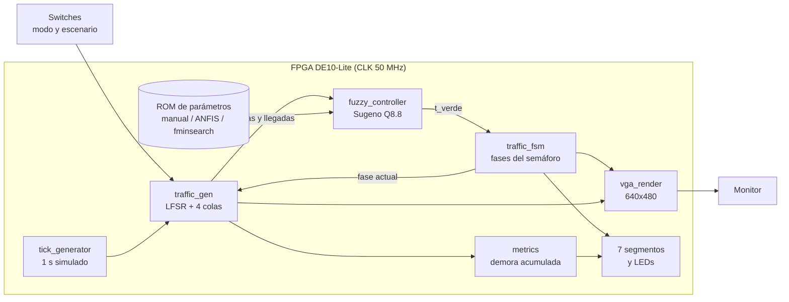
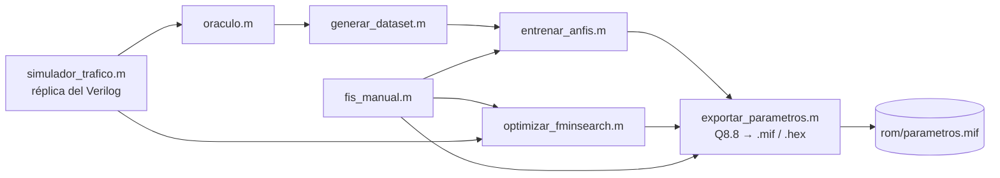

# Proyecto final: Semáforo inteligente con control neurodifuso en FPGA DE10-Lite

**Miguel Ángel Sarmiento Luna · Juan Diego Acosta Ojeda**
Universidad de las Américas Puebla (UDLAP)
Departamento de Computación, Electrónica y Mecatrónica

---

> Este documento es el plan de implementación del proyecto. Conforme se avance, cada sección se irá sustituyendo por el reporte final con el mismo formato de las prácticas.

## 1. Descripción general

El proyecto consiste en un controlador de semáforo para la intersección de dos calles, norte-sur y este-oeste, con cuatro accesos independientes (norte, sur, este y oeste), implementado completamente en la FPGA DE10-Lite. En lugar de asignar tiempos fijos a cada fase, la duración del verde se calcula en cada ciclo con un controlador difuso tipo Sugeno, a partir del estado del tráfico en ambas calles.

Los parámetros del controlador (funciones de pertenencia y consecuentes de las reglas) se obtienen de dos formas: con reglas definidas a criterio y con entrenamiento ANFIS en MATLAB. Una vez entrenados, los parámetros se cuantizan a punto fijo y se almacenan en una ROM dentro del diseño, por lo que la FPGA opera de forma autónoma y MATLAB solo interviene en la etapa de desarrollo.

No se construirá una maqueta. El tráfico se genera dentro de la misma FPGA mediante un generador pseudoaleatorio y el estado de la intersección se presenta en un monitor por VGA, en los displays de 7 segmentos y en los LEDs de la tarjeta.

## 2. Objetivos

### Objetivo general

Diseñar e implementar en Verilog un controlador de semáforo adaptativo basado en lógica difusa, con parámetros ajustados mediante aprendizaje automático, y evaluar su desempeño frente a un controlador de tiempo fijo dentro de la FPGA DE10-Lite.

### Objetivos específicos

1. Implementar un generador de tráfico en hardware con cuatro accesos y tasas de llegada configurables mediante escenarios.
2. Implementar un controlador difuso Sugeno de orden cero en punto fijo Q8.8, con parámetros leídos desde ROM.
3. Diseñar en MATLAB una base de reglas manual y entrenar una segunda versión con ANFIS usando datos generados por una réplica del simulador.
4. Verificar que la salida del controlador en Verilog coincida con `evalfis` de MATLAB dentro de una tolerancia definida.
5. Medir la demora promedio por vehículo con cada modo de control y comparar los resultados.

## 3. Alcance

| Incluido | No incluido |
|---|---|
| Intersección de dos calles con cuatro accesos independientes, un carril por acceso | Giros a la izquierda y carriles múltiples |
| Dos fases vehiculares (norte-sur y este-oeste) | Fase peatonal |
| Tráfico generado en la FPGA (LFSR) | Sensores físicos y maqueta |
| Visualización en VGA, 7 segmentos y LEDs | Interfaz web o comunicación inalámbrica |
| Entrenamiento fuera de línea en MATLAB | Aprendizaje en línea dentro de la FPGA |
| Comparación de cuatro modos de control | Coordinación entre varias intersecciones |

## 4. Arquitectura del sistema



*Figura 1. Diagrama de bloques del sistema.*

El reloj de 50 MHz alimenta todo el diseño. Un pulso de habilitación marca cada segundo simulado, y su periodo se puede reducir con un switch para acelerar la simulación (x1 o x50). La salida VGA usa un reloj de 25 MHz generado con un PLL.

## 5. Descripción de los módulos

### 5.1 Generador de tráfico (`traffic_gen.v`)

La intersección tiene cuatro accesos (norte, sur, este y oeste), cada uno con su propia cola. Se usan cuatro LFSR de 16 bits con semillas distintas, uno por acceso. En cada segundo simulado, si el número generado por un LFSR es menor que el umbral de su acceso, llega un vehículo a esa cola. Los umbrales de los cuatro accesos se definen en conjunto mediante un escenario, seleccionado con los switches:

*Tabla 1. Escenarios de tráfico. Los valores son la probabilidad de llegada por segundo y, entre paréntesis, el flujo equivalente en veh/h.*

| Código | Escenario | Norte | Sur | Este | Oeste |
|:--:|---|:--:|:--:|:--:|:--:|
| `000` | Baja uniforme | 0.05 (180) | 0.05 (180) | 0.05 (180) | 0.05 (180) |
| `001` | Media uniforme | 0.12 (432) | 0.12 (432) | 0.12 (432) | 0.12 (432) |
| `010` | Alta uniforme | 0.18 (648) | 0.18 (648) | 0.18 (648) | 0.18 (648) |
| `011` | Calle principal norte-sur | 0.20 (720) | 0.20 (720) | 0.05 (180) | 0.05 (180) |
| `100` | Calle principal este-oeste | 0.05 (180) | 0.05 (180) | 0.20 (720) | 0.20 (720) |
| `101` | Un acceso cargado | 0.25 (900) | 0.03 (108) | 0.10 (360) | 0.10 (360) |
| `110` | Hora pico asimétrica | 0.22 (792) | 0.15 (540) | 0.15 (540) | 0.08 (288) |
| `111` | Demanda cambiante | Alterna entre `011` y `100` cada 15 min simulados | | | |

Cada cola es un contador de 6 bits (0 a 63) con saturación. Mientras una fase tiene verde, cada uno de sus dos accesos descarga un vehículo cada 2 s, lo que corresponde a un flujo de saturación de 1800 veh/h por carril, un valor típico en vías urbanas [[5]](#referencias). Los escenarios se eligieron por debajo de la capacidad de la intersección, salvo `010`, que se acerca a ella para probar el comportamiento bajo carga alta. El escenario `111` sirve para observar cómo se adapta cada controlador cuando la demanda cambia de calle.

El módulo también entrega el número de llegadas de cada acceso en los últimos 30 s, que se usa como entrada del controlador.

### 5.2 Máquina de estados del semáforo (`traffic_fsm.v`)

*Tabla 2. Fases del semáforo.*

| Estado | Norte-sur | Este-oeste | Duración |
|---|:--:|:--:|---|
| `NS_VERDE` | Verde | Rojo | Calculada por el controlador (5 a 40 s) |
| `NS_AMARILLO` | Amarillo | Rojo | 3 s |
| `ROJO_TOTAL_1` | Rojo | Rojo | 1 s |
| `EO_VERDE` | Rojo | Verde | Calculada por el controlador (5 a 40 s) |
| `EO_AMARILLO` | Rojo | Amarillo | 3 s |
| `ROJO_TOTAL_2` | Rojo | Rojo | 1 s |

Al entrar a cada fase verde, la FSM solicita al controlador la duración correspondiente y espera la señal `done` antes de iniciar el conteo. Las duraciones de amarillo y rojo total son fijas en todos los modos. Por construcción, la FSM nunca permite dos verdes simultáneos; esta condición se comprueba también con una aserción en el testbench.

### 5.3 Controlador difuso (`fuzzy_controller.v`)

**Entradas** (para la fase que está por recibir el verde):

| Variable | Descripción | Rango |
|---|---|---|
| $x_1$ | Cola mayor de los dos accesos que reciben el verde | 0 a 63 veh |
| $x_2$ | Cola mayor de los dos accesos que quedan en rojo | 0 a 63 veh |
| $x_3$ | Llegadas recientes al acceso más cargado de la fase que recibe el verde | 0 a 30 veh |

Se toma el máximo de cada par porque la duración del verde depende del acceso crítico de la fase, es decir, el que tiene más demanda [[5]](#referencias). Si el verde alcanza para desalojar la cola mayor, también alcanza para la del acceso opuesto. Con este criterio el controlador conserva tres entradas y 27 reglas aunque la intersección tenga cuatro colas.

**Salida:** duración del verde $t_v$, de 5 a 40 s.

Cada entrada tiene tres funciones de pertenencia triangulares (baja, media, alta), lo que da $3^3 = 27$ reglas. Se usa el modelo Sugeno de orden cero, que es el que entrena `anfis` [[1]](#referencias)[[2]](#referencias):

$$t_v = \frac{\sum_{i=1}^{27} w_i z_i}{\sum_{i=1}^{27} w_i}, \qquad w_i = \mu_{A_i}(x_1)\,\mu_{B_i}(x_2)\,\mu_{C_i}(x_3) \qquad (1)$$

donde $z_i$ es el consecuente constante de la regla $i$. Se usa el producto como operador AND porque es el que emplea ANFIS; de lo contrario la FPGA no reproduciría el modelo entrenado.

**Decisiones de implementación:**

- Una función triangular con vértices $a \le b \le c$ requiere dividir entre $(b-a)$ y $(c-b)$. Para evitar divisores, MATLAB precalcula los recíprocos y los guarda en la ROM, de modo que cada grado de pertenencia se obtiene con una resta y una multiplicación.
- Las 27 reglas se evalúan secuencialmente, una por ciclo, con dos multiplicadores para el producto y uno para $w_i z_i$. Los dos acumuladores tienen 32 bits.
- La división final se hace con un divisor secuencial de restauración de 32 ciclos.
- El cálculo completo toma menos de 100 ciclos (menos de 2 µs), despreciable frente a la escala de segundos del semáforo.

**Organización de la ROM** (palabras de 16 bits en Q8.8):

| Contenido | Palabras |
|---|:--:|
| 3 entradas × 3 funciones × ($a$, $b$, $c$, $1/(b-a)$, $1/(c-b)$) | 45 |
| 27 consecuentes $z_i$ | 27 |
| Reserva | 56 |
| **Total por conjunto de parámetros** | **128** |

La ROM almacena cuatro conjuntos (512 palabras, una sola M9K). Los switches de modo seleccionan el conjunto con los dos bits más altos de la dirección. El modo de tiempo fijo usa un conjunto con todos los consecuentes iguales a 20 s, así que no requiere lógica adicional.

### 5.4 Métricas (`metrics.v`)

En cada segundo simulado se suma el total de vehículos en espera de las cuatro colas. Esta suma acumulada es la demora total en vehículo-segundo. También se cuentan los vehículos atendidos y se registra la cola máxima alcanzada en cualquier acceso. La demora promedio por vehículo es el cociente de ambos valores; para calcularlo se reutiliza el mismo divisor secuencial. `KEY1` reinicia las métricas para comenzar una nueva medición.

### 5.5 Visualización (`vga_sync.v`, `vga_render.v`)

Resolución de 640×480 a 60 Hz con reloj de 25 MHz (ALTPLL). Se dibuja el cruce con sus cuatro accesos, los tres focos de cada semáforo y un rectángulo por cada vehículo en cola, hasta 12 por acceso. Las cifras numéricas se muestran en los displays de 7 segmentos para no requerir una ROM de caracteres. Si queda tiempo, se agregará texto en la VGA.

### 5.6 Interfaz con la tarjeta

*Tabla 3. Asignación de entradas y salidas.*

| Elemento | Función |
|---|---|
| `SW[1:0]` | Modo: `00` tiempo fijo, `01` difuso manual, `10` ANFIS, `11` fminsearch |
| `SW[4:2]` | Escenario de tráfico (Tabla 1) |
| `SW[5]` | Velocidad de simulación: x1 o x50 |
| `SW[7:6]` | Contenido de los displays (Tabla 4) |
| `SW[9:8]` | Reservados |
| `KEY0` | Reinicio general |
| `KEY1` | Reinicio de métricas |
| `LEDR[5:0]` | Focos rojo, amarillo y verde de cada fase |
| `LEDR[9:8]` | Modo activo |

Con seis dígitos no caben las cuatro colas y el tiempo restante a la vez, por lo que el contenido de los displays se elige con `SW[7:6]`:

*Tabla 4. Contenido de los displays de 7 segmentos.*

| `SW[7:6]` | `HEX1-HEX0` | `HEX3-HEX2` | `HEX5-HEX4` |
|:--:|:--:|:--:|:--:|
| `00` | Tiempo restante de la fase | Cola norte | Cola sur |
| `01` | Tiempo restante de la fase | Cola este | Cola oeste |
| `10` | Demora promedio (s) | Vehículos atendidos (dígitos bajos) | Vehículos atendidos (dígitos altos) |
| `11` | Duración del último verde | Cola máxima registrada | Escenario y modo |

Se reutilizan los módulos `tick_generator.v` y `button_onepulse.v` de la Práctica 3, y `Bin_Bcd.v` y `decoder_7seg.v` de la Práctica 2.

## 6. Entrenamiento en MATLAB

Se usará MATLAB R2022b con Fuzzy Logic Toolbox y Fixed-Point Designer. MATLAB no es necesario para ejecutar el sistema; solo genera los archivos de parámetros que Quartus integra al bitstream.



*Figura 2. Flujo de obtención de parámetros.*

1. **`simulador_trafico.m`**: réplica del generador de tráfico y de la FSM, con el mismo polinomio y la misma semilla del LFSR. Debe producir exactamente la misma secuencia de colas que el Verilog; esto se comprueba en la etapa de verificación.
2. **`fis_manual.m`**: construye el FIS con funciones y reglas definidas a criterio. Por ejemplo: si la cola en verde es alta y la cola en rojo es baja, el verde es largo.
3. **`oraculo.m`**: para un estado dado, simula todas las duraciones de verde posibles (5 a 40 s) con la misma secuencia de llegadas y elige la que minimiza la demora acumulada durante los dos ciclos siguientes. Así se obtiene la salida deseada para el entrenamiento.
4. **`generar_dataset.m`**: recorre estados con distintas densidades y obtiene pares (entradas, $t_v$ óptimo). Se separa un 70 % para entrenamiento y un 30 % para validación.
5. **`entrenar_anfis.m`**: crea el FIS inicial con `genfis` (partición en rejilla, `trimf`, salida `constant`) y lo entrena con `anfis`. Se conserva el FIS con menor error de validación.
6. **`optimizar_fminsearch.m`**: variante sin oráculo. Ajusta los consecuentes del FIS manual para minimizar directamente la demora promedio que entrega el simulador. Es opcional y se hará si el tiempo lo permite.
7. **`exportar_parametros.m`**: verifica que $a \le b \le c$ en cada función (ANFIS puede desordenar los vértices) y que las funciones cubran todo el rango de cada entrada, para que $\sum w_i$ nunca sea cero. Después cuantiza con objetos `fi` a Q8.8 y escribe `parametros.mif` para Quartus y `parametros.hex` para simulación.
8. **`vectores_prueba.m`**: genera entradas aleatorias y la salida de `evalfis` para cada conjunto, en un archivo que lee el testbench.

## 7. Verificación

| Nivel | Prueba | Criterio de aceptación |
|---|---|---|
| Módulo | Testbench de cada módulo en Icarus Verilog / Active-HDL | Salidas correctas en casos límite (colas en 0 y en 63, cambios de modo) |
| Controlador | 1000 vectores de `vectores_prueba.m` contra `fuzzy_controller.v` | Error absoluto máximo menor a 0.5 s respecto a `evalfis` |
| Simulador | Misma semilla en MATLAB y en Verilog durante 3600 s simulados | Secuencias de colas idénticas |
| Seguridad | Aserción sobre las salidas de la FSM | Nunca hay dos verdes simultáneos |
| Tarjeta | Ejecución con cada modo y escenario | Los resultados coinciden con la simulación |

## 8. Experimentos

Cada combinación se ejecuta durante una hora simulada (72 s reales en x50), siempre con la misma semilla para que todos los modos reciban exactamente el mismo tráfico.

*Tabla 5. Plantilla de resultados: demora promedio por vehículo (s).*

| Escenario | Tiempo fijo | Difuso manual | ANFIS | fminsearch |
|---|:--:|:--:|:--:|:--:|
| `000` Baja uniforme | | | | |
| `001` Media uniforme | | | | |
| `010` Alta uniforme | | | | |
| `011` Calle principal norte-sur | | | | |
| `100` Calle principal este-oeste | | | | |
| `101` Un acceso cargado | | | | |
| `110` Hora pico asimétrica | | | | |
| `111` Demanda cambiante | | | | |

Además de la demora promedio se registrarán la cola máxima y los vehículos atendidos. Se espera que los modos adaptativos muestren la mayor ventaja en los escenarios asimétricos (`011` a `111`), donde el tiempo fijo desperdicia verde en la calle con poco tráfico. En los escenarios uniformes la diferencia debería ser menor.

## 9. Recursos estimados

Estimación preliminar, que se actualizará con el reporte de compilación de Quartus:

| Recurso | Disponible (10M50) | Estimado |
|---|:--:|:--:|
| Elementos lógicos | 49,760 | menos de 5,000 |
| Multiplicadores 9×9 | 288 | 6 a 10 |
| Bloques M9K | 182 | 2 a 4 |
| PLL | 4 | 1 |

## 10. Estructura de archivos

```
ProyectoFinal/
├── README.md               Plan y, posteriormente, reporte final
├── matlab/                 Simulador, FIS, entrenamiento y exportación
├── rtl/                    Módulos Verilog del diseño
├── rom/                    parametros.mif y parametros.hex
├── tb/                     Testbenches y vectores de prueba
├── quartus/                Proyecto, asignación de pines (.qsf) y .pof
└── img/                    Capturas y gráficas para el reporte
```

## 11. Cronograma

| Semana | Actividades | Entregable |
|:--:|---|---|
| 1 | `traffic_fsm.v` con tiempo fijo, displays y LEDs. `traffic_gen.v` y su réplica en MATLAB | Semáforo de tiempo fijo funcionando en la tarjeta |
| 2 | `fis_manual.m`, `exportar_parametros.m` y `fuzzy_controller.v` con su testbench | Controlador validado contra `evalfis` |
| 3 | Integración del controlador con la FSM. Oráculo, dataset y entrenamiento ANFIS | Modos manual y ANFIS en la tarjeta |
| 4 | Salida VGA y módulo de métricas. `optimizar_fminsearch.m` (opcional) | Sistema completo |
| 5 | Experimentos, captura de resultados y redacción del reporte | Reporte final y presentación |

## 12. Riesgos y mitigación

| Riesgo | Impacto | Mitigación |
|---|---|---|
| La réplica en MATLAB no coincide con el Verilog | Los parámetros entrenados no corresponden al sistema real | Comparar ambas trazas ciclo a ciclo desde la semana 1, antes de entrenar |
| Pérdida de precisión al cuantizar a Q8.8 | Diferencias entre FPGA y MATLAB | Medir el error con `fi` antes de sintetizar y, si es necesario, pasar a Q8.12 |
| ANFIS produce funciones con vértices desordenados o fuera de rango | Grados de pertenencia incorrectos en hardware | Validar y corregir en `exportar_parametros.m` |
| El oráculo es lento con muchos estados | Retraso en el entrenamiento | Reducir el horizonte o el número de muestras; el cálculo se hace una sola vez |
| Problemas de temporización en la VGA | Imagen inestable | Dejar la VGA para la semana 4; los displays bastan para validar el controlador |
| ANFIS no mejora al controlador manual | Resultado menos interesante | Es un resultado válido; se documenta y se analiza la causa |

## 13. Entregables

1. Código Verilog del sistema y sus testbenches.
2. Scripts de MATLAB para simulación, entrenamiento y exportación de parámetros.
3. Proyecto de Quartus con el archivo `.pof` grabado en la flash de la tarjeta.
4. Reporte final en este mismo archivo, con las secciones usadas en las prácticas.
5. Demostración en la tarjeta con monitor VGA.

## Referencias

[1] J.-S. R. Jang, "ANFIS: Adaptive-network-based fuzzy inference system," *IEEE Transactions on Systems, Man, and Cybernetics*, vol. 23, no. 3, pp. 665-685, 1993.

[2] T. Takagi y M. Sugeno, "Fuzzy identification of systems and its applications to modeling and control," *IEEE Transactions on Systems, Man, and Cybernetics*, vol. SMC-15, no. 1, pp. 116-132, 1985.

[3] C. P. Pappis y E. H. Mamdani, "A fuzzy logic controller for a traffic junction," *IEEE Transactions on Systems, Man, and Cybernetics*, vol. 7, no. 10, pp. 707-717, 1977.

[4] Terasic Technologies, *DE10-Lite User Manual*.

[5] F. V. Webster, *Traffic Signal Settings*, Road Research Technical Paper No. 39, Road Research Laboratory, Londres, 1958.

[6] The MathWorks, Inc., *Fuzzy Logic Toolbox User's Guide*, documentación de `genfis` y `anfis`, R2022b.
