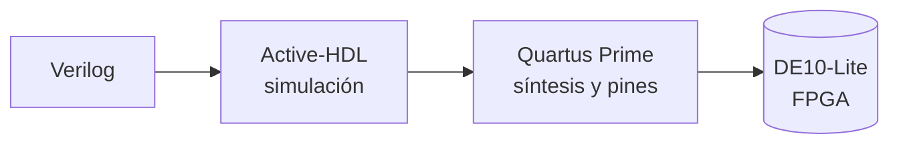

# 🔌 Sistemas Embebidos

**Código y reportes de prácticas con FPGA**

🎓 **Universidad de las Américas Puebla (UDLAP)**
Departamento de Computación, Electrónica y Mecatrónica

---

## 👥 Equipo

| Integrante |
|---|
| 🧑‍💻 Miguel Ángel Sarmiento Luna |
| 🧑‍💻 Juan Diego Acosta Ojeda |

## 🛠️ Plataforma y herramientas

| | Herramienta | Uso |
|:--:|---|---|
| 🧩 | **Terasic DE10-Lite** | Tarjeta FPGA (interruptores, botones, LEDs y displays de 7 segmentos) |
| 📝 | **Verilog** | Descripción del hardware |
| 🧪 | **Active-HDL** | Compilación y simulación |
| ⚙️ | **Quartus Prime Lite** | Síntesis, asignación de pines y programación |

## 📚 Prácticas

Cada carpeta contiene el código Verilog y, en su propio `README.md`, el reporte correspondiente.

| # | Práctica | Descripción | Reporte |
|:--:|---|---|:--:|
| 1️⃣ | **Sumadores** | Half/full adder, sumadores de 4 y 16 bits y display de 7 segmentos | [📄 Ver](Practica1/) |
| 2️⃣ | **ALU de 5 bits** | Suma, resta y multiplicación con signo y despliegue decimal | [📄 Ver](Practica2/) |
| 3️⃣ | **Contador con signo** | Contador de 9 bits controlado con botones y displays | [📄 Ver](Practica3/) |
| 4️⃣ | **UART** | Transmisor y receptor serial en la DE10-Lite | [📄 Ver](Practica4/) |

## 📝 Formato de los reportes

Todos los reportes siguen las mismas secciones:

| | Sección | | Sección |
|:--:|---|:--:|---|
| 1 | Resumen | 5 | Análisis de resultados |
| 2 | Objetivos | 6 | Cuestionario |
| 3 | Marco teórico | 7 | Conclusión |
| 4 | Planteamiento del experimento | 8 | Referencias |

---

Sistemas Embebidos · UDLAP

